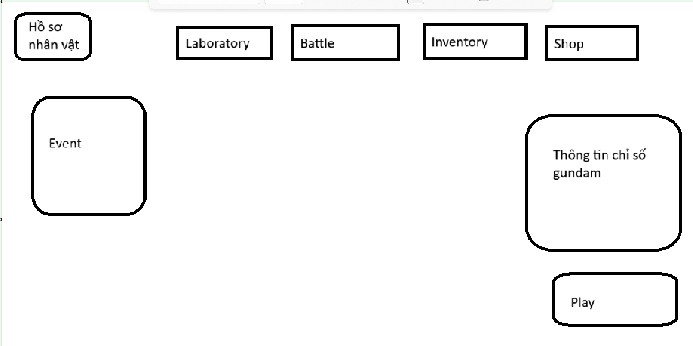
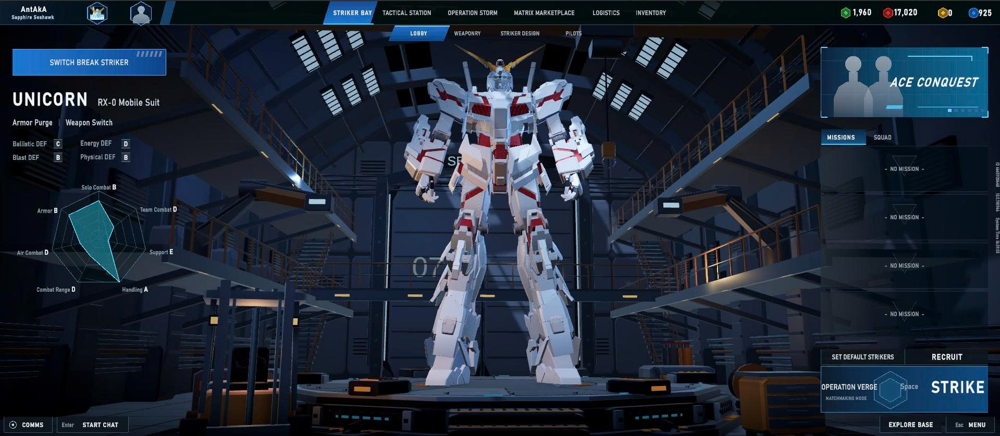

# Thiết kế game AR Transformer Gundam

Game Design Document phiên bản 0.1 · Ngày 31 tháng 10 năm 2026

Tài liệu dành cho nhóm ba thành viên phát triển AR Transformer Gundam. Mục tiêu là thống nhất trải nghiệm chơi, phạm vi sản phẩm và điều kiện nghiệm thu để triển khai PvE Chapter 1 trước. Định hướng dài hạn có PvP rank và phát hành thương mại; các điều kiện về thiết bị, tài nguyên và quyền sử dụng cần được giải quyết trước khi phát hành.

## 1 Định hướng sản phẩm

Người chơi chỉ huy đội ba Gundam trong trận chiến theo lượt dựa trên Speed. Trong lượt của một Gundam, người chơi chọn mục tiêu và một trong bốn kỹ năng. Khi địch tấn công, người chơi phản ứng bằng Dodge hoặc Parry theo timing. Laboratory giúp xem Gundam, focus bộ phận và chuẩn bị trang bị trước trận.

**Trải nghiệm cốt lõi:** xây đội có vai trò bổ trợ, quyết định dùng Burst hay giữ tài nguyên, phá giáp đúng mục tiêu và chủ động phòng thủ trong lượt địch. AR đưa Gundam hoặc chiến trường vào không gian thực để người chơi quan sát từ nhiều góc.

**Người chơi mục tiêu đề xuất:** người yêu thích mecha và game chiến thuật theo lượt trên điện thoại. Cần thử với người chơi thật để đánh giá độ dễ hiểu, thời lượng trận và sự thuận tiện của AR.

**Quy ước quyết định:** “Đã chốt” là yêu cầu người dùng xác nhận; “Đề xuất” là phương án cần duyệt; “Demo hiện tại” mô tả bản thử, không phải cam kết đã hoàn thành tính năng sản phẩm. Các mã D01 đến D12 ở mục 19 tập hợp quyết định còn mở.

### Cách đọc nhanh

- Mục 2 đến 5: phạm vi, giao diện trung tâm và vòng chơi Story.
- Mục 6 đến 9: luật combat, tài nguyên và thiết kế địch.
- Mục 10 đến 14: tiến trình, AR, AI, cloud và PvP.
- Mục 15 đến 20: tài nguyên, chất lượng, nghiệm thu, triển khai và nguồn tham khảo.

**Ưu tiên triển khai đã chốt:** PvE trước; Chapter 1 có năm màn; mỗi người điều khiển ba Gundam. Bản GDD này không đổi cấu trúc thư mục hoặc sửa model trong Unity.

<!-- PAGE -->

## 2 Phạm vi sản phẩm và yêu cầu môn học

**Đã chốt:** Main GUI có Hồ sơ, Laboratory, Battle, Inventory, Shop, bảng chỉ số và nút Play. Inventory có vật phẩm EXP và đá nâng cấp. Laboratory focus và tô sáng bộ phận thay cho thao tác tháo rời. Battle có PvE và PvP rank; giai đoạn hiện tại ưu tiên Story.

**Phạm vi bàn giao đề xuất:** một vòng chơi PvE 3v3 hoàn chỉnh, Chapter 1 đủ năm màn, ít nhất ba Gundam chơi được với bộ kỹ năng khác vai trò, Laboratory, Inventory và Shop tối thiểu; có AR thật, mô hình học sâu, APK và đọc ghi cloud qua backend chạy bằng Docker. Ba Gundam đầu tiên cần chọn tại D03. Sở hữu mười bộ model chưa có nghĩa mười nhân vật đã sẵn sàng chơi.

| Tiêu chí | Điểm | Minh chứng cần chuẩn bị |
| --- | --- | --- |
| Unity 2D and 3D implementation | 20 | UI 2D tương tác với hangar, model, camera, animation và trận 3D |
| AR implementation and deep learning model | 20 | AR trên thiết bị thật; mô hình đã huấn luyện quyết định hành động trong game; báo cáo đánh giá |
| Mobile deployment | 20 | APK cài và hoàn thành luồng chơi trên Android thật |
| IO cloud integration | 20 | Đọc và ghi hồ sơ, inventory, tiến trình; mở lại game lấy đúng dữ liệu |
| Docker use | 20 | Dựng và chạy backend bằng container; game gọi API đang hoạt động |

**Cách dùng rubric:** đây là bảng tổng quan do người dùng cung cấp. Nhóm cần lấy mô tả chấm chi tiết trước khi đóng phạm vi; không suy ra rằng có một chức năng là tự động đạt 20 điểm. “Supporting work deduction 0 hoặc −20” chưa có định nghĩa cụ thể, cần xác nhận với giảng viên.

**Lộ trình sau PvE:** PvP rank online 3v3 vẫn thuộc định hướng game. Training, nhiệm vụ tài nguyên và Event động là các phần mở rộng. Nhận diện bàn tay, tháo lắp thật, thế giới mở và dùng chung tọa độ AR giữa nhiều máy chưa thuộc gói PvE đầu tiên.

<!-- PAGE -->

## 3 Main GUI và điều hướng

Hình 1. Bố cục chức năng do người dùng đề xuất. Giữ các vùng nhiệm vụ rõ ràng và dành trung tâm cho Gundam đang chọn trên bệ hangar. Kích thước và vị trí trên mobile cần điều chỉnh theo safe area, không sao chép nguyên kích thước ảnh.

**Đề xuất luồng điều hướng:** Main GUI mở các màn hoặc panel có nút quay lại nhất quán. Play và Battle → PvE cùng dẫn tới màn chọn nội dung PvE; Battle → PvP mở đấu trường khi tính năng được phát triển. Các mục chưa mở cần ghi trạng thái rõ ràng.

- Hồ sơ hiển thị tên, avatar, cấp tài khoản, coin và tiến trình đồng bộ.
- Laboratory chọn Gundam sở hữu, xem bộ phận, nâng cấp và chuẩn bị vũ khí/core.
- Inventory xem số lượng, mô tả và sử dụng vật phẩm; Shop mua bằng coin.
- Bảng chỉ số theo Gundam đang chọn; thay Gundam phải cập nhật model, tên và biểu đồ cùng lúc.
- Event có thể bắt đầu bằng một nhiệm vụ cố định; nội dung và phần thưởng cần duyệt trước khi triển khai.

**Trạng thái UI cần có:** đang tải, chưa có vật phẩm, thiếu coin, đồng bộ thất bại, giao dịch đang xử lý và nút bị khóa có lý do. Người chơi không mất tiến trình chỉ vì đóng một panel.

<!-- PAGE -->

## 4 Laboratory và bảng thuộc tính

Hình 2. Tham chiếu hình ảnh cho bệ trưng bày, không gian mecha và cách biểu diễn thuộc tính. Ảnh là nguồn tham khảo bố cục; tài nguyên giao diện của sản phẩm cần được tạo hoặc có quyền sử dụng phù hợp.

**Đã chốt:** chọn một bộ phận sẽ làm vùng đó sáng lên và focus để xem thông tin. Model không bị tháo rời. **Đề xuất:** danh mục gồm đầu, thân/core, tay, chân, backpack và vũ khí. Camera chuyển mềm tới góc phù hợp; bấm Tổng quan để khôi phục góc ban đầu.

Mỗi vùng được liên kết tới nhóm mesh hoặc một cơ chế mask tương ứng. Model nguyên khối cần đánh giá riêng trước khi hứa highlight chính xác. Nâng cấp giai đoạn đầu áp dụng cho Gundam; thay trang bị giới hạn ở vũ khí/core là đề xuất cần duyệt.

**Biểu đồ đề xuất:** sáu trục HP, Armor, Attack, Def, Speed và Break Dmg, dùng cùng thang chuẩn giữa các nhân vật. Giá trị mỗi trục bằng chỉ số chia mốc chuẩn, giới hạn hình vẽ từ 0 đến 1; vẫn hiện số thật cạnh biểu đồ. Burst có năm ô riêng. Bảng ngoài trận hiển thị chỉ số sau nâng cấp/trang bị, không dùng HP đang mất từ một trận khác.

Thay đổi trang bị chỉ được xác nhận khi vật phẩm tồn tại và hợp lệ với Gundam. Cần giữ lựa chọn cũ nếu tải dữ liệu hoặc lưu trang bị thất bại.

<!-- PAGE -->

## 5 Vòng chơi PvE và Chapter 1

**Vòng chơi đề xuất:** Main GUI → chọn Story → chọn màn → chuẩn bị đội ba Gundam → chuẩn bị chiến trường → chiến đấu → kết quả → nhận thưởng → nâng cấp/trang bị → màn tiếp theo.

**Đề xuất khởi đầu:** cấp sẵn ba Gundam hoàn chỉnh để người chơi có thể vào trận đầu tiên mà không cần mua. Danh tính, vai trò và trang bị khởi đầu của bộ ba được chốt tại D03.

**Đã chốt:** Chapter 1 có năm màn. Ba màn đầu là quái thường; màn 4 có một tinh anh và hai quái thường; màn 5 có một boss và hai quái thường.

| Màn | Thành phần địch | Mục tiêu trải nghiệm đề xuất |
| --- | --- | --- |
| 1 | Quái thường; đề xuất ba địch | Chọn mục tiêu, nhận biết lượt và dùng chiêu cơ bản |
| 2 | Quái thường; đề xuất ba địch | Quản lý Burst, phân biệt HP và Armor |
| 3 | Quái thường; đề xuất ba địch | Phối hợp đội hình và luyện phản ứng phòng thủ |
| 4 | Một tinh anh và hai quái thường | Ưu tiên mục tiêu và xử lý đặc tính tinh anh |
| 5 | Một boss và hai quái thường | Vận dụng các cơ chế và đọc tín hiệu đòn mạnh |

**Đề xuất điều kiện:** mở màn tiếp theo khi thắng màn hiện tại; thắng khi toàn bộ địch bị hạ, thua khi cả ba đồng minh bị hạ. Bản đầu không hồi sinh hoặc thay Gundam giữa trận. Chưa đặt giới hạn thời gian trận; theo dõi lượt và thời gian để cân bằng sau thực nghiệm.

Vào trận mới, mỗi Gundam hồi đầy HP và Armor, Burst về 2/5. Việc giữ trạng thái giữa nhiều màn chưa được yêu cầu. Chơi lại màn có thể nhận thưởng lặp; phần thưởng lần đầu được ghi riêng và chỉ nhận một lần. Số lượng và giá trị phần thưởng thuộc D08.

Training, nhiệm vụ EXP và nhiệm vụ đá nâng cấp là hướng mở rộng trong menu PvE. Nội dung mới cần nối vào cùng cơ chế chọn đội, chiến đấu và kết quả thay vì tạo một hệ combat riêng.

<!-- PAGE -->

## 6 Đội hình thuộc tính và lịch hành động

**Đã chốt:** mỗi người điều khiển ba Gundam. Mỗi Gundam có HP, Armor, Attack, Def, Speed, Break Dmg và Burst riêng. Speed nằm trong khuôn khổ thiết kế 120 đến 160. Cách giới hạn Speed sau trang bị/buff cần duyệt tại D05.

**Đề xuất đội hình:** ba ô cố định; không có di chuyển tự do hoặc né bằng joystick. Mỗi loại Gundam chỉ xuất hiện một lần trong đội ở bản đầu, chờ D03. Người chơi chọn hành động của Gundam có lượt hiện tại, không được điều khiển tùy ý một đồng minh khác để bỏ qua lịch lượt.

| Lớp dữ liệu | Nội dung | Quy tắc |
| --- | --- | --- |
| Cấu hình Gundam | Chỉ số gốc, giới hạn cấp, bộ skill, prefab, nhóm bộ phận | Dùng chung theo loại, không ghi HP đang mất vào asset |
| Hồ sơ sở hữu | Cấp, EXP, tiến trình nâng cấp, trang bị đã chọn | Lưu theo tài khoản |
| Chỉ số hiệu lực | MaxHP, MaxArmor, Attack, Def, Speed, Break Dmg sau điều chỉnh | Tính riêng theo PvE hoặc PvP |
| Trạng thái trận | CurrentHP, CurrentArmor, CurrentBurst, trạng thái sống, thời điểm lượt | Tồn tại riêng cho từng actor trong trận |

Ví dụ: Gundam có MaxHP 1.200, sau khi trúng đòn còn CurrentHP 900. Cấu hình MaxHP không bị đổi thành 900. Burst của đồng minh A không dùng để trả chi phí skill của B.

**Đề xuất lịch lượt:** thời gian chờ bằng 10.000 chia Speed; chọn actor có thời điểm hành động sớm nhất. Chỉ đẩy lịch của actor vừa hoàn tất hành động; địch đã chết bị bỏ khỏi lịch. Khi đổi Speed, quy tắc giữ tiến độ phải được đặc tả trước khi thêm buff tốc.

Nếu hòa lượt, dùng chỉ số thứ tự khởi tạo ổn định trong trận. Trong PvE có thể ưu tiên đồng minh; PvP cần quy tắc không thiên vị một người cố định. Đây là D05. Timeline và lượt thực tế phải dùng chung nguồn dữ liệu.

<!-- PAGE -->

## 7 Kỹ năng mục tiêu và Burst

**Đã chốt:** mỗi Gundam có ba chiêu và một ulti. Burst tối đa năm ô, bắt đầu trận với hai ô. Chiêu 1 hồi một ô; cuối lượt hoàn tất của chính Gundam đó hồi một ô. Hồi bị giới hạn ở năm; lượt địch hoặc đồng minh khác không tự hồi Burst cho actor này.

| Kỹ năng | Chi phí | Hồi khi hoàn tất chiêu | Hồi cuối lượt | Thay đổi ròng trước khi chạm trần |
| --- | --- | --- | --- | --- |
| Chiêu 1 | 0 | +1 | +1 | +2 |
| Chiêu 2 | 1 | 0 | +1 | 0 |
| Chiêu 3 | 2 | 0 | +1 | −1 |
| Full Burst | 5 | 0 | +1 | −4 |

Ví dụ: bắt đầu 2 ô, dùng chiêu 1 xong có 4; lượt riêng kế tiếp dùng chiêu 1 đạt 5; lượt riêng thứ ba có thể dùng ulti, sau khi hoàn tất còn 1. Đây là ba lượt của cùng Gundam, không phải ba lượt chung của toàn trận.

**Đã chốt về thao tác:** trong lượt của mình được chọn bất kỳ địch hợp lệ, không bị ép đánh từ trái sang phải. Đề xuất giữ lựa chọn khi mục tiêu còn sống; khi mục tiêu bị hạ, chuyển sang một địch hợp lệ và cập nhật UI.

**Luồng ra lệnh đề xuất:** chọn mục tiêu → chọn skill → xem trước chi phí/phạm vi → Execute. Xác nhận lại Burst và mục tiêu trước khi chạy; trừ chi phí một lần, khóa đổi lệnh trong animation, gây sát thương tại các mốc hit, hồi Burst đúng một lần rồi chuyển lượt.

Mẫu Strike Rouge hiện có Beam Rifle, Anti Ship Blade, Ootori Missiles và Full Burst. Súng/kiếm đánh đơn, tên lửa đánh toàn bộ, ulti có mục tiêu chính và lan. Phạm vi của mỗi skill là dữ liệu riêng, không áp cùng mẫu cho mọi Gundam.

**Đề xuất bản đầu:** ulti dùng trong lượt actor; không có chen lượt hoặc cooldown bổ sung ngoài Burst. Hủy giữa chừng và hoàn trả tài nguyên cần quy tắc riêng tại D06. Ulti đủ năm ô phải có tín hiệu hình và chữ rõ ràng.

<!-- PAGE -->

## 8 Phòng thủ giáp và sát thương

**Đã chốt:** mỗi đòn chỉ chọn Dodge hoặc Parry; hai phản ứng không cộng dồn. Sai timing không được giảm sát thương từ phản ứng. Các điều kiện dùng chỉ số hiệu lực tại thời điểm xử lý đòn.

| Phản ứng đúng timing | So sánh | Kết quả |
| --- | --- | --- |
| Dodge | Speed người né lớn hơn người đánh | Né thành công 100% |
| Dodge | Speed người né nhỏ hơn hoặc bằng người đánh | 50% xác suất né; thất bại nhận sát thương thông thường |
| Parry | Def nhân 1,25 lớn hơn Attack người đánh | Chặn toàn bộ sát thương |
| Parry | Def nhân 1,25 nhỏ hơn hoặc bằng Attack người đánh | Nhận 50% sát thương |

**Đã chốt về giáp:** Armor còn dương giảm 50% sát thương HP sau khi tính Def. Hết giáp thì mất lớp giảm đó. Sát thương giáp cơ sở bằng 0,5 Attack cộng 0,5 Break Dmg; không phải lấy 50% thanh giáp tối đa. Hệ số từng skill cần cân bằng riêng.

$$ D_{Armor} = 0.5 \times Attack + 0.5 \times BreakDmg $$

**Đề xuất D01:** sát thương HP trước lớp giáp dùng công thức dưới, với c là hệ số skill và K khởi điểm 100. Đây chưa phải công thức đã chốt hoặc đã thay vào demo.

$$ D_{HPraw} = Attack \times c \times \frac{K}{K + Def} $$

Trình tự đề xuất: tính chỉ số và sát thương → giải quyết phản ứng → áp hệ số phản ứng lên cả kênh HP/Armor → dùng trạng thái giáp trước hit để giảm HP → trừ tài nguyên → báo phá giáp/chết. Dodge thành công và Parry chặn hết cho hai kênh bằng 0. Làm tròn HP ở cuối; hit có sát thương dương tối thiểu 1 HP. Ví dụ Attack 100, c bằng 1, Def 80, K bằng 100 cho khoảng 56 HP trước giáp, khoảng 28 khi còn giáp.

**Đề xuất D02 và D04:** một cửa sổ phản ứng cho mỗi hành động địch; đòn nhiều hit/AOE dùng lựa chọn đó, mỗi Gundam bị đánh tự so chỉ số. Tổng phá giáp của một skill chia cho các hit, tránh nhân theo số hit. Hit vừa phá giáp vẫn hưởng lớp giảm HP ban đầu; chưa thêm choáng hoặc tự hồi giáp giữa trận.

Timing demo đang dùng Parry 0,20 giây và Dodge 0,40 giây trước impact. Đây là thông số thử; chưa được xác nhận phù hợp màn cảm ứng hoặc trận 3v3.

<!-- PAGE -->

## 9 Quái thường tinh anh và boss

**Đã chốt:** màn 4 và 5 đều có hai quái thường hỗ trợ một địch mạnh. **Đề xuất:** tạo ba vai trò địch cơ bản và tái sử dụng model qua cấu hình, màu nhận diện và bộ hành động phù hợp.

| Vai trò đề xuất | Hành vi chính | Cách người chơi đối phó |
| --- | --- | --- |
| Striker | Gây sát thương đơn, có tín hiệu ngắm trước đòn mạnh | Đỡ/né đúng timing hoặc tập trung hạ sớm |
| Guard | Chống chịu tốt, hỗ trợ giáp cho một đồng đội | Dùng phá giáp và chọn mục tiêu theo tình huống |
| Breaker | Gây áp lực Armor, đòn mạnh cần tích tài nguyên | Kiểm soát mục tiêu và bảo vệ actor có giáp thấp |

**Tinh anh đề xuất:** một biến thể có đặc tính “bảo vệ tuyến sau”. Mỗi lượt của nó chỉ dùng một hành động; kỹ năng bảo vệ có tín hiệu và giới hạn rõ. Người chơi được thử hai cách: phá giáp tinh anh trước hoặc loại quái hỗ trợ.

**Boss đề xuất:** một trạng thái cơ bản và một trạng thái cường hóa khi HP xuống ngưỡng thử 50%. Cường hóa đổi cách chọn chiêu hoặc tăng áp lực, không tự sinh thêm lượt vô hạn. Đòn AOE mạnh cần báo trước bằng tín hiệu khác đòn thường. Tên, ngưỡng, số liệu và hiệu ứng vẫn là nội dung cần duyệt tại D09.

Các hành động phải tuân theo chi phí, lượt và mục tiêu hợp lệ. Boss không được gây sát thương trước tín hiệu impact. Kỹ năng bảo vệ, hồi giáp hoặc buff là phần mở rộng có chủ đích; cần thiết kế dữ liệu và test riêng trước khi đưa vào đội hình.

Mô hình học sâu ưu tiên thử ở một địch/tinh anh hoặc boss. Logic chọn hành động có thể học; điều kiện hợp lệ, thực thi chiêu và tính sát thương do hệ combat kiểm soát. Các trận dùng cùng seed và cấu hình được lưu để tái hiện lỗi.

Mục tiêu thực nghiệm đề xuất: người chơi mới hiểu lý do thất bại và biết có thể đổi mục tiêu, đội hình hoặc timing. Ghi số lượt, thời gian trận, tỷ lệ thắng và lượng giáp bị phá; chưa công bố số liệu trước khi đo.

<!-- PAGE -->

## 10 Inventory Shop và tiến trình

**Đã chốt:** Inventory có bình EXP, đá nâng cấp và các vật phẩm cơ bản. Shop mua Gundam/vũ khí bằng coin. Coin nhận từ nội dung chiến đấu; nguồn PvP được triển khai cùng đấu trường sau.

| Đối tượng | Vai trò thiết kế | Quy tắc bản đầu đề xuất |
| --- | --- | --- |
| Bình EXP | Tăng EXP và cấp Gundam được chọn | Trừ số lượng và tăng EXP trong cùng giao dịch |
| Đá nâng cấp | Tài nguyên nâng cấp Gundam | Dùng cùng coin tại các mốc nâng cấp được cấu hình |
| Coin | Đơn vị mua và nâng cấp | Không âm; server xác nhận số dư và chi phí |
| Vũ khí | Thay phong cách hoặc chỉ số trang bị | Quy định tương thích theo loại Gundam |
| Core | Trang bị lõi do nhóm sáng tạo | Chỉ số/nội tại cần duyệt; Burst vẫn là tài nguyên của actor |

**Đề xuất luồng sử dụng:** Inventory → chọn bình EXP → chọn Gundam → xem trước kết quả → xác nhận → cập nhật kho và chỉ số. Laboratory dùng cùng dịch vụ nâng cấp. Không tiêu vật phẩm nếu Gundam đạt giới hạn hoặc yêu cầu không hợp lệ.

**Đề xuất luồng mua:** Shop → xem nội dung và giá → xác nhận → backend kiểm tra coin/quyền sở hữu → trả trạng thái mới. Nút bị khóa khi giao dịch đang chạy. Mua Gundam trùng có thể bị từ chối ở bản đầu; chưa thêm đổi mảnh hoặc cơ chế quay ngẫu nhiên.

Shop chỉ bán Gundam có đủ bộ skill và dùng được sau mua. Nếu mới hoàn thiện ba nhân vật khởi đầu, danh mục thử nghiệm ưu tiên vũ khí/vật phẩm; thêm Gundam bán khi đã hoàn chỉnh nhân vật tiếp theo. Đây là đề xuất thu hẹp nội dung để duyệt ở D08.

Phần thưởng Story gồm coin và vật phẩm theo cấu hình. Lần đầu và chơi lại có bảng thưởng riêng. Một kết quả trận chỉ được nhận một lần dù người chơi bấm lại hoặc gửi lại yêu cầu sau lỗi mạng. Tồn kho, số dư và tiến trình cần được cập nhật nhất quán.

**Chưa chốt D08:** giới hạn cấp, đường cong EXP, số mốc nâng cấp, giá Shop, lượng thưởng và danh mục core/vũ khí. GDD không đặt giá tiền thật hoặc cam kết doanh thu. Chưa đưa hệ stamina vào phạm vi PvE đầu tiên.

<!-- PAGE -->

## 11 Trải nghiệm AR và sân ảo

**Đã chốt:** AR là yêu cầu sản phẩm và môn học. **Chưa chốt D07:** AR bắt buộc cho mọi trận hay là một chế độ song song; chiến trường gắn mặt phẳng, hologram neo trong không gian hay nhận diện thẻ. Các phương án đã thảo luận là đề xuất, không xem là người dùng đã chọn.

| Phương án | Trải nghiệm | Điều kiện |
| --- | --- | --- |
| Mặt phẳng | Sân thu nhỏ trên bàn hoặc sàn | Nhận diện mặt phẳng ngang và chọn vùng đủ chỗ |
| Hologram trong không gian | Bàn chỉ huy lơ lửng trước người chơi | Tracking môi trường và anchor ở pose xác định; không cần khẳng định đó là sàn |
| Thẻ ảnh | Nội dung xuất hiện tại ảnh đã đăng ký | Có ảnh tham chiếu và camera nhận diện được |

**Đề xuất giai đoạn đầu:** hoàn thiện một cách đặt AR ổn định; đồng thời giữ sân ảo để phát triển và chạy trên máy không hỗ trợ. Laboratory AR là phần tiếp theo nếu đủ thời gian. ARCore hỗ trợ anchor theo session hoặc trackable [S1]; nhận diện ảnh là tính năng khác [S2].

**Luồng đề xuất:** kiểm tra hỗ trợ → xin quyền camera theo hệ điều hành → hướng dẫn quan sát môi trường → preview vị trí → tự đặt khi ổn định hoặc xác nhận một lần → tạo anchor chung cho chiến trường → triển khai đội hình. Tự đặt không có nghĩa bỏ tracking. Tránh spawn vào pose suy đoán rồi gọi đó là mặt sàn thật.

Khi mất tracking, tạm dừng lượt, animation, timer phòng thủ và input combat. Khi tracking phục hồi, tiếp tục từ trạng thái đã giữ; không làm mất cơ hội phản ứng. Đặt lại sân không reset tài nguyên hoặc cấp thêm phần thưởng. Camera điện ảnh ulti phải khôi phục góc và trạng thái AR sau khi kết thúc.

Sân ảo cần cho xoay/zoom bằng chuột hoặc cảm ứng; AR đổi góc chủ yếu bằng chuyển động thiết bị. Trên máy không hỗ trợ, báo rõ chế độ ảo. Bản build và ma trận hỗ trợ cần xác nhận trước demo; Game View không thay thế kiểm thử AR thật.

<!-- PAGE -->

## 12 Mô hình học sâu và thực nghiệm AI

**Đã chốt về yêu cầu:** phần deep learning phải có mô hình thực sự tham gia hành vi địch. **Đề xuất D10:** huấn luyện một policy chọn hành động theo trạng thái trận, bắt đầu bằng PPO qua ML Agents nếu thử nghiệm tương thích thành công. Thuật toán cụ thể được khóa sau một bài thử nhỏ; không ghi nhận kết quả học khi chưa chạy.

Đầu vào đề xuất gồm HP/MaxHP, Armor/MaxArmor, Burst/5, trạng thái sống, Speed và actor hiện tại của sáu Gundam; chỉ dùng dữ liệu quan sát hợp lệ. Chuẩn hóa chỉ số bằng mốc cấu hình. Thứ tự các ô đội hình và phiên bản đầu vào phải cố định giữa training và runtime.

Đầu ra chọn skill và mục tiêu. Có thể mã hóa thành tối đa 12 tổ hợp bốn skill nhân ba mục tiêu; mask tổ hợp thiếu Burst hoặc có mục tiêu đã chết. Skill AOE dùng một lựa chọn chuẩn thay vì ba bản sao tương đương. Hệ combat kiểm tra lại hành động trước khi thi triển.

**Môi trường đề xuất:** mô phỏng luật combat không cần camera AR hoặc hiệu ứng hình ảnh để tăng tốc huấn luyện. Timing của đối thủ trong training dùng một mô hình phản ứng có cấu hình, không đọc trước input tương lai của người chơi. Bộ luật dùng chung hoặc phải có test đối chiếu với game thật.

**Đánh giá:** so với bot random hợp lệ và bot luật đơn giản trên cùng các đội hình/seed kiểm thử tách khỏi training. Lưu reward curve, tỷ lệ thắng, lượt kết thúc, thời gian inference và tỷ lệ hành động bị từ chối. Đề xuất tối thiểu 100 trận mỗi cấu hình kiểm thử; con số thực đạt được phải báo cáo trung thực. Đánh giá nhiều seed để tránh kết luận từ một chuỗi may mắn.

ML Agents có thể xuất mô hình để suy luận trong Unity [S3]. Việc có sẵn package Inference Engine chưa chứng minh model đã được huấn luyện hoặc tương thích với mọi toán tử. Cần thử export và inference trên Android thật trước khi mở rộng.

Nếu tải model hoặc inference lỗi, dùng bot luật dự phòng và ghi rõ sự kiện. Bài demo deep learning phải chứng minh policy đang được gọi, không chỉ dùng fallback. Cấu hình reward, checkpoint, phiên bản dữ liệu và kết quả thuộc tài liệu AI chuyên biệt tiếp theo.

<!-- PAGE -->

## 13 Cloud Docker và ranh giới kỹ thuật

**Yêu cầu bàn giao:** game đọc ghi dữ liệu cloud và sử dụng Docker có thể trình diễn. **Đề xuất:** backend API và database; container chạy trên máy chủ, ứng dụng Unity gọi API qua HTTPS. Lựa chọn nhà cung cấp, ngôn ngữ backend và database chốt trong TDD sau một thử nghiệm kết nối.

| Nhóm dữ liệu | Nội dung | Thẩm quyền đề xuất |
| --- | --- | --- |
| Hồ sơ và quyền sở hữu | Người chơi, Gundam, inventory, coin | Backend xác thực và lưu |
| Loadout và nâng cấp | Cấp, EXP, vũ khí, core | Backend kiểm tra điều kiện; client hiển thị |
| Story và phần thưởng | Màn đã mở, lần thắng đầu, kết quả đã nhận | Backend ngăn nhận trùng; quy tắc xác minh kết quả cần đặc tả |
| Trạng thái trận PvE | HP, Armor, Burst, lượt, seed | Runtime combat; không ghi vào asset model |
| Cấu hình cân bằng | Chỉ số, skill, giá và thưởng | Có version để client/backend dùng cùng bộ dữ liệu |

Các luồng API cần có: tạo/khôi phục phiên đăng nhập, tải hồ sơ, tải inventory, lưu loadout, nâng cấp, mua hàng, bắt đầu trận và nhận kết quả. TDD sẽ chốt schema, mã lỗi, timeout, retry và khóa chống xử lý lặp. Không dùng ID do client tự khai như bằng chứng xác thực tài khoản.

Không tin số coin hoặc lượng thưởng client gửi lên. Server tính phần thưởng từ màn và cấu hình, gắn mã trận để chống nhận lặp. Chống kết quả PvE giả cần cơ chế xác minh riêng tại D11; giao dịch an toàn không tự chứng minh toàn bộ trận đã được mô phỏng trên server.

Dockerfile cần tạo image chạy được. Compose mô tả service, network, health check và lưu trữ bền vững [S4]. Bí mật nằm trong cấu hình môi trường, không đưa vào repo hoặc APK. Chạy container tại laptop và triển khai dịch vụ cloud là hai minh chứng khác nhau.

Khi mất mạng, bản đầu có thể cho thử combat không thưởng và giữ thông báo đồng bộ. Quyền chơi offline, hàng đợi ghi dữ liệu và cách xử lý xung đột cần chốt tại D11 trước khi quảng bá khả năng offline.

<!-- PAGE -->

## 14 Định hướng PvP rank

**Đã chốt:** mỗi người điều khiển ba Gundam; PvP ưu tiên đấu rank. Giai đoạn thực hiện hiện tại vẫn là PvE. Không thay yêu cầu đấu rank bằng phòng bạn bè như một quyết định mặc định.

| Bậc | Tên tiếng Anh | Nhận diện đề xuất |
| --- | --- | --- |
| 1 | Cadet | Đồng, một vạch quân hiệu |
| 2 | Pilot | Bạc, cánh cơ khí |
| 3 | Veteran | Vàng, khiên và sao |
| 4 | Commander | Tím, huy hiệu chỉ huy |
| 5 | Marshal | Đỏ viền vàng, huy hiệu cao nhất |

Người dùng yêu cầu năm bậc bằng tiếng Anh. Chuỗi tên trên là đề xuất gần nhất trong trao đổi, cần duyệt lần cuối tại D12; tên Chiến tướng/ACE trước đó không tự trở thành tên phát hành.

**Đã chốt về chuẩn hóa:** Gundam dùng mức chỉ số tối đa của chính loại đó, độc lập với tiến trình PvE. Vũ khí và core dùng trạng thái mặc định, không nâng cấp. Chỉ số vào trận bằng chỉ số thân Gundam tối đa cộng bonus mặc định từ trang bị hợp lệ. Không cộng lại bonus trang bị đã tính trong cấu hình. Mỗi actor bắt đầu Burst 2/5, không tự đầy ulti.

Chuẩn hóa tiến trình không làm mọi loại Gundam có cùng HP/Attack/Speed. Nội tại, bộ chiêu và tổ hợp ba nhân vật vẫn cần cân bằng. Quyền dùng nhân vật chưa sở hữu và khả năng chọn trùng trong đội chưa chốt.

Điểm rank, ngưỡng lên/xuống bậc, placement, matchmaking, mùa và xử lý bỏ trận thuộc thiết kế PvP sau. Kết quả và cập nhật rank cần server xác nhận. Dodge/Parry online phải có quy tắc đồng bộ thời gian, độ trễ và mất kết nối trước khi phát triển.

Hai máy có thể hiển thị chiến trường ở các pose AR riêng và đồng bộ trạng thái logic. Đồng bộ cùng một vị trí vật lý là một yêu cầu AR nhiều người riêng, chưa nằm trong phạm vi đã xác nhận.

<!-- PAGE -->

## 15 Tài nguyên hình ảnh âm thanh và bản demo

Thư viện hiện có mười bộ model theo thông tin người dùng và thư mục thực tế. Tên hiển thị, tư cách nhân vật độc lập của bản Part 2 và quyền sử dụng cần được rà soát trước khi đưa vào catalog game.

| Nhóm tài nguyên | Tên thư mục hoặc bộ model |
| --- | --- |
| Bốn bộ người dùng cho biết được tạo thêm | BlueFlame; HaoLing; SkyDefender; Kamiki Burning Gundam |
| Sáu bộ tải về | Unicorn Gundam; MBF 02 Strike Rouge Ootori; EXtreme Application ONEXtreme GUNDAM; RX 78 2 Gundam; RX 78 2 Gundam Part 2; ZGMF X09A Justice Gundam |

**Đã chốt về bảo toàn:** giữ nguyên thư mục Models và chưa unpack/chia lại các bộ tải về trong công việc tài liệu này. Tính năng sản phẩm nên dùng prefab/config trung gian; thay đổi nguồn asset cần task riêng.

**Hướng art đề xuất:** mecha quân sự, khung cắt góc, nền tối, cyan cho tương tác, đỏ cho mục tiêu/nguy hiểm, amber cho Burst đầy. Hình, chữ và âm thanh phải cùng báo trạng thái; không dựa riêng vào màu. Giảm hiệu ứng khi nó che cue phản ứng hoặc thanh HP.

Âm thanh cần tối thiểu: chọn/xác nhận/hủy, bắt đầu lượt, cảnh báo impact, Dodge/Parry, phá giáp, Burst đầy, ulti, thắng/thua. Bản đầu có tùy chỉnh âm lượng và mức rung; quyền sử dụng nhạc, giọng nói và SFX được ghi nhận cùng model.

**Demo hiện tại:** hướng dẫn project mô tả Strike Rouge 1v3 với HUD, bốn chiêu, Burst năm ô, Armor, chọn địch và camera ảo. Đây là nền thử nghiệm; chưa phải hệ đội hình ba đồng minh, Chapter 1 hoặc PvP. Các báo cáo cũ chỉ xác nhận phiên bản đã kiểm tra tại thời điểm ghi.

**Phát hành:** mục tiêu doanh thu đã được nêu, nhưng giấy phép thương mại chưa được xác minh. Cần kiểm tra quyền đối với file model và IP nhân vật/tên/logo riêng. Nguồn chính thức xác nhận hoạt động bảo vệ và cấp phép Gundam [S5]. GDD chưa xác nhận đủ quyền phát hành, kể cả với model được tự dựng hoặc sinh thêm.

<!-- PAGE -->

## 16 Chất lượng mobile và khả năng sử dụng

**Đã chốt:** ưu tiên Android trước; có định hướng Android, iOS và iPad. Đợt bàn giao đề xuất dùng Android làm nền tảng kiểm chứng đầu tiên. Việc có provider ARKit trong project chưa đồng nghĩa đã build/test iOS.

Project được kiểm tra đang dùng Unity 6000.5.8f1, AR Foundation/ARCore/ARKit 6.5.0, URP 17.5.0, Input System 1.20.0 và Inference Engine 2.6.1. Đây là ảnh chụp cấu hình ngày lập GDD, không phải yêu cầu tự nâng package.

**Mục tiêu đề xuất để đo:** đạt tối thiểu 30 FPS trên máy Android tham chiếu đã chọn, chạy trận liên tục ít nhất 15 phút không crash hoặc tăng bộ nhớ không kiểm soát. Đo trên thiết bị thật với một cấu hình hình ảnh cố định; chưa có kết quả chứng minh đạt mục tiêu này.

- UI ngang, tôn trọng notch/safe area và tỷ lệ màn hình; thử các tỷ lệ 16:9, màn dài và 4:3.
- Nút phải đủ lớn để bấm bằng ngón tay; skill thiếu tài nguyên có giải thích. Có màn hướng dẫn ngắn cho Burst, chọn mục tiêu và timing.
- Timeline ghi rõ actor đang hành động. HP/Armor/Burst của actor đang chọn không bị nhầm với dữ liệu toàn đội.
- Hiệu ứng được tái sử dụng bằng pooling, có giới hạn số hạt và ánh sáng. Cần đo draw call, texture, renderer và model sau khi dựng đủ sáu actor.
- Ứng dụng tạm dừng hoặc mất tracking phải giữ trạng thái hợp lệ; khi tiếp tục không chạy bù hàng loạt impact.

Kiểm tra thiết bị dựa trên danh sách hỗ trợ chính thức và trạng thái runtime [S6]. Máy không hỗ trợ AR có thể thử sân ảo nếu bản build cho phép. Không dùng bản giả lập hoặc quay camera nền làm bằng chứng tracking AR thật.

Mục tiêu thời lượng một trận và mức độ dễ của timing được xác định bằng thử nghiệm người chơi tại D09. Theo dõi thao tác sai, số lần không hiểu lượt, tỷ lệ phản ứng thành công và sự thoải mái khi cầm máy trong chế độ AR.

<!-- PAGE -->

## 17 Kiểm thử và điều kiện nghiệm thu

Các mục dưới là tiêu chí phải kiểm tra trong bản sản phẩm mới, không phải danh sách đã hoàn thành. Báo cáo test ghi phiên bản build, thiết bị, ngày, bước thực hiện, kết quả mong đợi và bằng chứng.

| Mã | Tình huống | Kết quả cần có |
| --- | --- | --- |
| T01 | Chọn đội và vào Story | Có đúng ba actor người chơi; dữ liệu riêng cho mỗi actor |
| T02 | Đến lượt và chọn địch bất kỳ | Đòn đơn trúng mục tiêu đã chọn; đổi target không tốn lượt |
| T03 | Dùng bốn skill | Chi phí 0/1/2/5; hồi đúng actor, đúng một lần; không âm hoặc vượt năm |
| T04 | Timing và biên chỉ số | Chỉ một phản ứng; xử lý đúng dấu lớn hơn và trường hợp bằng |
| T05 | Đòn nhiều hit và phá giáp | Không nhân tổng phá giáp theo số hit; break event phát đúng một lần |
| T06 | Đồng minh/địch bị hạ | Bỏ khỏi lượt và mục tiêu; thắng/thua đúng khi hết đội |
| T07 | Hoàn thành Chapter 1 | Đúng năm màn; màn 4/5 có thành phần địch đã chốt; mở khóa đúng |
| T08 | AR mất tracking và đặt lại | Timer dừng, trạng thái được giữ; không thưởng lại hoặc reset Burst |
| T09 | Cloud và giao dịch gửi lặp | Mua/nâng cấp/nhận thưởng không bị trừ hoặc cộng hai lần |
| T10 | Đóng và mở lại app | Phục hồi hồ sơ, sở hữu, inventory và tiến trình đã đồng bộ |
| T11 | Policy AI và fallback | Chứng minh gọi model thật; mask hợp lệ; lỗi được ghi nhận |
| T12 | Docker và mobile | Dựng backend theo hướng dẫn, app kết nối được; APK chạy trên thiết bị |

**Hoàn thành một tính năng** khi có luồng người chơi dùng được, trạng thái lỗi được xử lý, dữ liệu hợp lệ, kiểm thử đạt và hướng dẫn cho hai thành viên còn lại. **Hoàn thành gói PvE** khi đi hết luồng Main GUI → Story → chiến đấu → nhận thưởng → lưu/tải lại, đồng thời có minh chứng cho năm tiêu chí môn học.

Kịch bản trình diễn đề xuất: mở hồ sơ cloud → vào Laboratory → chọn bộ phận → dùng EXP → chọn đội → đặt sân AR → đánh một trận có policy học sâu → nhận thưởng → mở lại app xác minh lưu → trình bày container/API và kết quả AI. Demo Chapter 1 đầy đủ có thể trình bày thêm qua video không cắt bước quan trọng.

<!-- PAGE -->

## 18 Trình tự phát triển và phối hợp nhóm

Người dùng cho biết nhóm có ba thành viên, quỹ ban đầu hai tháng và bản thân dành khoảng bốn giờ mỗi ngày. Thời hạn còn lại và số giờ của hai thành viên khác chưa xác nhận; vì vậy các mốc dưới theo thứ tự phụ thuộc, chưa gắn ngày hoàn thành tuyệt đối.

| Mốc | Kết quả bàn giao | Điều kiện chuyển bước |
| --- | --- | --- |
| M0 Chốt thiết kế nền | Duyệt phạm vi PvE, đội hình, sát thương, phản ứng AOE và hướng AR | D01/D02/D03/D07 có quyết định |
| M1 Combat 3v3 | Sáu actor, lượt, mục tiêu, Burst riêng, thắng/thua và một màn thử | T01 đến T06 đạt trên sân ảo |
| M2 Vòng tiến trình | Main GUI, Laboratory, inventory, nâng cấp, Shop, kết quả và lưu dữ liệu | Đi hết một vòng chơi; giao dịch chống lặp |
| M3 Chapter 1 | Năm màn cấu hình được, tinh anh và boss có đặc tính | T07 đạt; số liệu cân bằng được ghi |
| M4 Các tích hợp môn học | AR thiết bị thật, policy học sâu, backend cloud và Docker | Các spike sớm đã qua; T08 đến T12 đạt |
| M5 Đóng bản | APK ổn định, hướng dẫn, báo cáo, video và minh chứng | Chạy lại checklist và kiểm tra rubric chi tiết |

AR, cloud/Docker và export AI cần có bài thử nhỏ ngay khi bắt đầu M1, dù nghiệm thu tích hợp ở M4. Nếu đợi hoàn thành toàn bộ gameplay mới kiểm tra khả năng chạy trên máy thật, rủi ro phát hiện lỗi nền tảng sẽ quá muộn.

**Phân vai đề xuất:** thành viên A phụ trách combat và dữ liệu; B phụ trách UI/Laboratory/AR/mobile; C phụ trách backend/Docker và pipeline AI. Đổi vai theo năng lực thực tế; AI và tích hợp phải có người thứ hai review. Đây chưa phải phân công được ba người xác nhận.

Mỗi task có owner, dependency, đầu ra và test nghiệm thu trong backlog. Thay công thức cần cập nhật version cấu hình và test; tránh để GDD, code và model training dùng ba bộ luật khác nhau. Chốt một lát cắt chơi được trước khi bổ sung nhiều model hoặc hiệu ứng.

<!-- PAGE -->

## 19 Sổ quyết định cần duyệt

Các yêu cầu “Đã chốt” trong tài liệu không nằm trong bảng này. Các dòng dưới là lựa chọn còn mở; phương án đề xuất giúp nhóm có nội dung cụ thể để duyệt, không tự tạo thành yêu cầu chính thức.

| Mã | Quyết định | Phương án đề xuất và thời điểm cần chốt |
| --- | --- | --- |
| D01 | Công thức HP và thứ tự sát thương | Công thức có K, Def và hệ số skill ở mục 8; trước M1 |
| D02 | Phản ứng cho multi hit và AOE | Một lựa chọn cho hành động địch, từng actor so chỉ số riêng; trước M1 |
| D03 | Ba Gundam đầu và chọn trùng | Strike Rouge làm mẫu, chọn thêm hai bộ; cấp sẵn bộ ba và không trùng loại trong đội là đề xuất; trước M1 |
| D04 | Đòn phá giáp và hồi giáp | Hit phá vẫn có bảo vệ giáp; không tự hồi giáp/choáng bản đầu; trước M1 |
| D05 | Lịch lượt và giới hạn Speed | AV 10.000/Speed; quy tắc hòa xác định và giới hạn sau bonus; trước M1 |
| D06 | Ulti cooldown và hủy hành động | Ulti trong lượt, dùng Burst làm giới hạn; định nghĩa hủy/hoàn tài nguyên; trước M1 |
| D07 | Trải nghiệm AR phát hành | Chọn một kiểu neo; quyết định AR bắt buộc hay tùy chọn; trước tích hợp AR |
| D08 | Tiến trình và kinh tế | Giới hạn cấp, EXP, đá, giá/thưởng, core/vũ khí; trước M2 |
| D09 | Độ khó và nội dung địch | Duyệt archetype, đặc tính elite/boss và thời lượng trận mục tiêu; trước M3 |
| D10 | Pipeline học sâu | Spike PPO/ML Agents, export và inference trên Android; chốt sau spike sớm |
| D11 | Cloud và offline | Nhà cung cấp, tài khoản, xác minh kết quả, retry và xử lý mất mạng; trước M2 |
| D12 | PvP và rank | Duyệt tên tiếng Anh; điểm, matchmaking, quyền sở hữu và luật mạng; sau PvE |

**Phiên duyệt đầu tiên đề xuất:** chốt D01, D02, D03 và D07. Nhóm có thể bắt đầu thiết kế dữ liệu và dựng đội hình ngay sau đó; các con số kinh tế và tên màn có thể tiếp tục hoàn thiện mà không chặn nền combat.

**Quyền phát hành:** xác minh giấy phép trước khi đưa tài nguyên vào bản phân phối thương mại. Việc xây dựng bản prototype không tự tạo quyền khai thác nhân vật hoặc các model tải về.

<!-- PAGE -->

## 20 Nguồn và tài liệu liên quan

**Nguồn yêu cầu:** trao đổi với chủ project đến ngày 31 tháng 10 năm 2026; checklist môn học năm mục 20 điểm; hai ảnh Main GUI và hangar do người dùng cung cấp. Các yêu cầu mới trong trao đổi được ưu tiên hơn nội dung cũ chưa cập nhật.

**Nguồn combat:** tài liệu “Thiet Ke Combat Gundam AR v0.1.docx” trong Docs/Planning. Bản gốc được giữ nguyên. GDD kế thừa Burst năm ô, phòng thủ, thuộc tính và công thức giáp; đánh dấu riêng các công thức/luật bổ sung còn cần duyệt.

**Nguồn project:** ProjectSettings/ProjectVersion.txt; Packages/manifest.json; Docs/Guides/StrikeRougeMechaHUD.md; Docs/Design/Models.md; tên thư mục Assets/Models. Đối chiếu ngày 31 tháng 10 năm 2026. Hướng dẫn và báo cáo demo là bằng chứng của phiên bản thử tương ứng, không thay cho kiểm thử gói PvE mới.

### Tham khảo kỹ thuật

- [S1 Google ARCore Working with Anchors](https://developers.google.com/ar/develop/anchors). Giải thích anchor theo trackable hoặc session và vị trí trong world space.
- [S2 Google ARCore Augmented Images](https://developers.google.com/ar/develop/augmented-images). Tham khảo nhận diện hình ảnh trong môi trường AR.
- [S3 Unity ML Agents Overview](https://unity-technologies.github.io/ml-agents/ML-Agents-Overview/). Tham khảo pipeline huấn luyện và inference; chưa chốt tương thích package cụ thể của project.
- [S4 Docker Compose Application Model](https://docs.docker.com/compose/intro/compose-application-model/). Tham khảo service, network và lưu trữ cho backend.
- [S5 Bandai Namco Protection of IP](https://www.bandainamco.co.jp/en/sustainability/materiality/ip/protection_rights.html). Nguồn chính thức về bảo vệ IP và hoạt động cấp phép Gundam; không phải giấy phép cho project này.
- [S6 Google ARCore Supported Devices](https://developers.google.com/ar/devices). Danh sách hỗ trợ thay đổi theo thời gian; kiểm tra lại trên thiết bị dùng để demo.

### Tài liệu nối tiếp

Từ GDD này, nhóm triển khai Combat and Progression Design, UI UX Design, Technical Design Document, AI Model and Experiment Design và Test and Deployment Plan. Backlog quản lý công việc được cập nhật cùng các mốc ở mục 18. UML, ERD, schema API và tham số training chi tiết thuộc các tài liệu chuyên biệt đó.

**Quản lý thay đổi:** sửa nội dung đã chốt phải có người quyết định, ngày và tác động lên combat/UI/dữ liệu/test. Bản Markdown là nguồn có thể so sánh thay đổi trong Git; bản Word phục vụ đọc, trao đổi và bàn giao. Khi sửa, cập nhật hai bản từ cùng nội dung để tránh lệch thiết kế.
