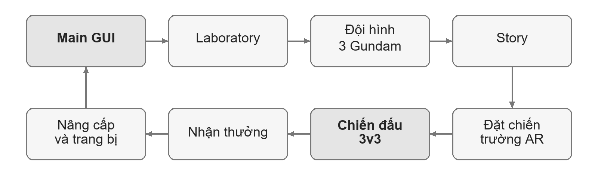
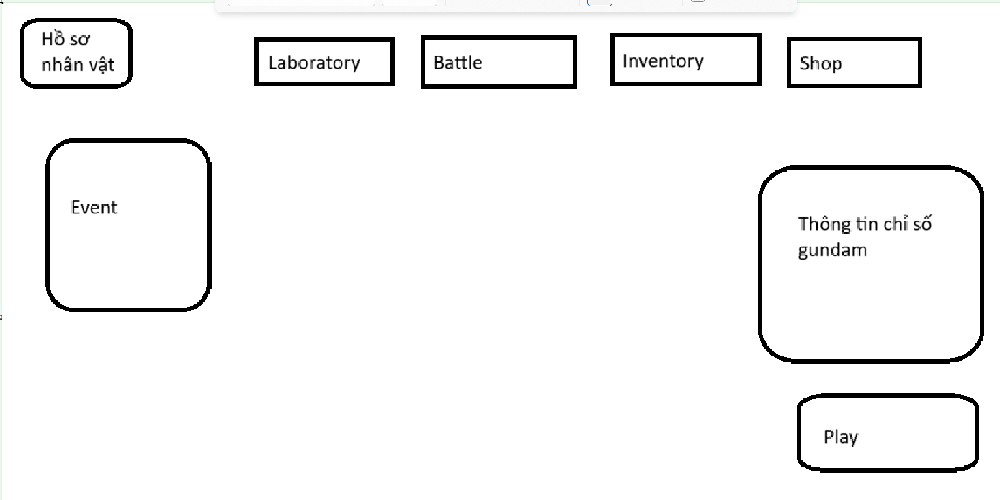
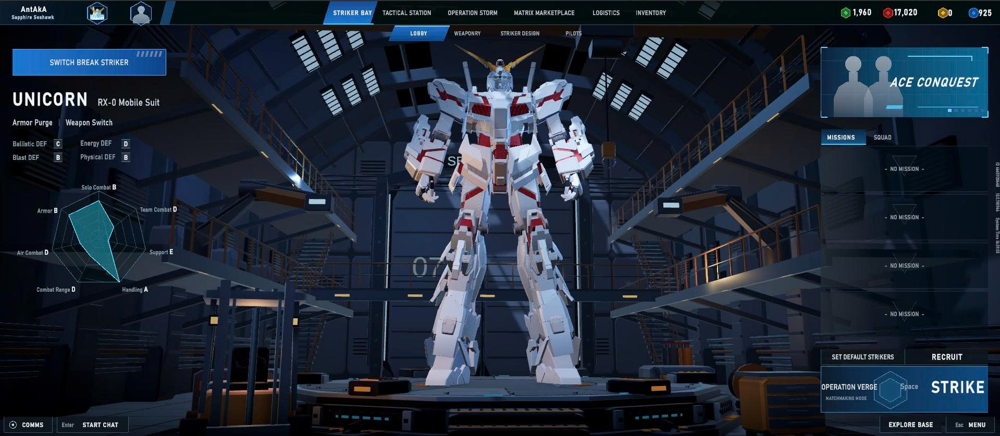
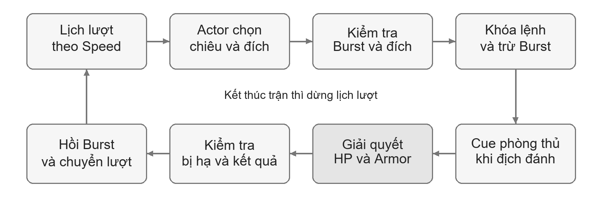
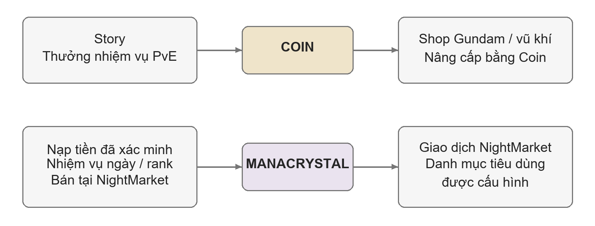
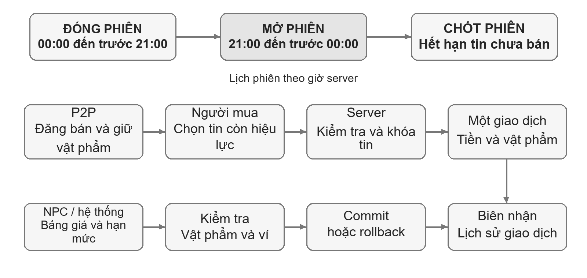
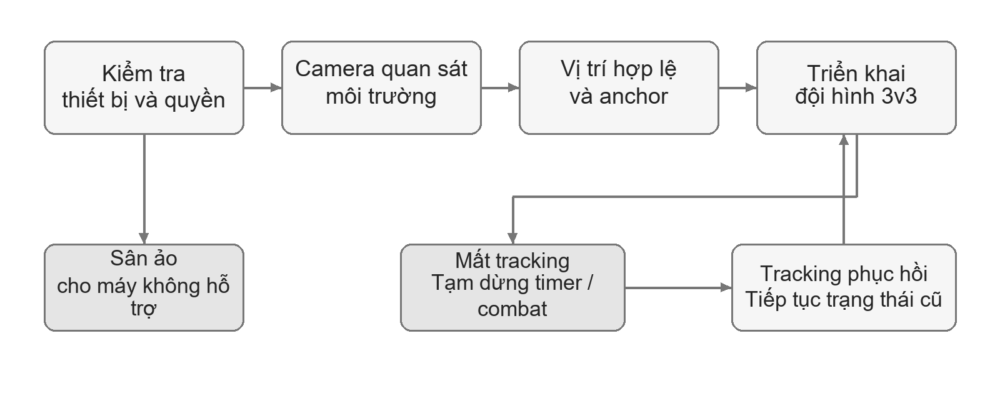
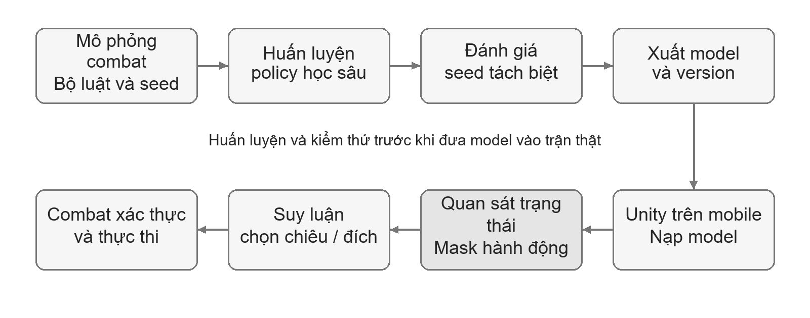
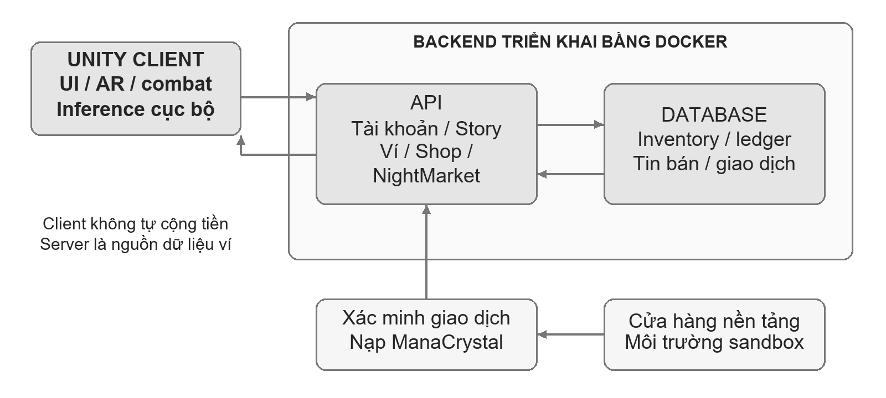

# Thiết kế game AR Transformer Gundam

GDD V0.1 · Bản hiệu chỉnh bố cục và kinh tế · Ngày 31 tháng 10 năm 2026

Tài liệu dành cho nhóm ba thành viên xây dựng AR Transformer Gundam. Phạm vi V0.1 đã được chủ project chấp thuận; bản hiệu chỉnh giữ nền thiết kế đó, tổ chức lại theo chương và bổ sung hệ tiền tệ cùng NightMarket. Nội dung phân biệt yêu cầu sản phẩm, thông số thử nghiệm và phần mở rộng sau V0.1. Bìa Word sử dụng bản trường và danh sách thành viên do chủ project cung cấp.

## 1 Tổng quan và phạm vi V0.1

### 1.1 Ý tưởng và trải nghiệm cốt lõi

AR Transformer Gundam là game chiến thuật theo lượt trên điện thoại. Người chơi chỉ huy đội ba Gundam, chọn mục tiêu và một trong bốn chiêu của actor đang có lượt. Lịch hành động dựa trên Speed; khi địch tấn công, người chơi có thể Dodge hoặc Parry đúng timing. AR đưa chiến trường hoặc Gundam vào không gian thực để quan sát từ nhiều góc.

Trải nghiệm cần tạo ra là cảm giác chỉ huy một đội mecha có vai trò bổ trợ: quản lý Burst, chọn lúc phá giáp, ưu tiên địch nguy hiểm và phản ứng trong lượt đối phương. Laboratory giúp người chơi hiểu nhân vật và chuẩn bị đội hình; Story, phần thưởng và nâng cấp tạo lý do quay lại.

Người chơi mục tiêu là người yêu thích mecha và chiến thuật theo lượt trên mobile. Độ dài trận, mức khó timing và sự thoải mái khi giữ điện thoại được đo trong thực nghiệm. Mục tiêu có doanh thu là định hướng dài hạn; V0.1 cần chứng minh vòng chơi và các tích hợp hoạt động trước khi phát hành thương mại.

### 1.2 Phạm vi đã duyệt và thứ tự ưu tiên

Nền V0.1 gồm Main GUI, Laboratory, Inventory, Shop, đội hình ba Gundam, combat theo Speed và Story Chapter 1 năm màn. Gói này có AR, deep learning, chạy Android, đọc ghi cloud và backend dùng Docker. Ưu tiên thực hiện hiện tại là PvE; PvP rank vẫn được giữ trong thiết kế và triển khai sau khi nền PvE ổn định.

| Hạng mục | Nội dung V0.1 | Ranh giới triển khai |
| --- | --- | --- |
| Nhân vật và combat | Ít nhất ba Gundam hoàn chỉnh, bốn skill mỗi actor, Burst riêng, giáp, Dodge và Parry | Mười model là thư viện; đưa từng nhân vật vào catalog khi đủ bộ chiêu và test |
| Story | Năm màn; ba màn thường, một tinh anh kèm hai quái, một boss kèm hai quái | Tập trung Chapter 1 |
| Quản lý đội | Laboratory focus bộ phận, chỉ số, inventory, nâng cấp và trang bị | Bộ phận được highlight; không tháo rời trong luồng chính |
| Kinh tế bổ sung | Coin, ManaCrystal, nhiệm vụ ngày, NightMarket P2P và NPC | NightMarket mở 21:00 đến 00:00 hằng ngày; nạp tiền kiểm thử bằng sandbox |
| Tích hợp | AR thực, policy học sâu, APK, dữ liệu cloud và Docker | Có minh chứng chạy thật cho từng tiêu chí |
| Phát triển tiếp | PvP rank, nội dung Training và nhiệm vụ tài nguyên | Phụ thuộc nền combat, dữ liệu và mạng |

Artifact được ghi nhận là hướng mở rộng Inventory sau V0.1. Chưa thiết kế số ô, bonus set, độ hiếm hoặc chỉ số phụ. Nhận diện bàn tay, tháo lắp từng chi tiết, thế giới mở và chia sẻ cùng tọa độ AR giữa nhiều máy chưa nằm trong gói đang triển khai.

### 1.3 Yêu cầu môn học và minh chứng

| Tiêu chí chấm | Điểm | Minh chứng cần chuẩn bị |
| --- | --- | --- |
| Unity 2D and 3D implementation | 20 | UI 2D tương tác với hangar, model, animation, camera và trận 3D |
| AR implementation and deep learning model | 20 | AR trên thiết bị hỗ trợ; model đã học được gọi trong trận; đánh giá AI |
| Mobile deployment | 20 | APK cài và chơi được trên Android thật |
| IO cloud integration | 20 | Đọc ghi hồ sơ, hai ví tiền, inventory, tiến trình và giao dịch |
| Docker use | 20 | Build và chạy backend bằng container; game gọi API hoạt động |

Tổng điểm cơ sở là 100. Mục Supporting work deduction có mức 0 hoặc −20 nhưng chưa có mô tả chấm chi tiết. Nhóm cần xác nhận yêu cầu báo cáo, phân công và minh chứng hỗ trợ với giảng viên. Có một tính năng không tự bảo đảm đạt trọn 20 điểm của tiêu chí tương ứng.

## 2 Trải nghiệm người chơi và giao diện

### 2.1 Vòng chơi chính

Người chơi chuẩn bị Gundam tại Laboratory, chọn đội và màn Story, đặt chiến trường rồi chiến đấu. Kết quả tạo ra Coin, EXP và vật phẩm để nâng cấp hoặc mua nội dung. Nhiệm vụ ngày và NightMarket mở thêm một nhánh quay lại ngoài Story.

Hình 1. Vòng chơi chính của PvE; các màn dùng chung hệ đội hình, combat và phần thưởng.

Đội hình khởi đầu cần có sẵn ba Gundam dùng được để người mới vào trận mà chưa cần mua. Danh tính và vai trò của bộ ba được chọn theo khả năng hoàn thiện model/animation; Strike Rouge là mẫu combat đang có. Khi thêm một nhân vật, cần đủ chỉ số, bốn chiêu, trang bị tương thích, chân dung và test.

### 2.2 Main GUI và điều hướng

Hình 2. Bố cục chức năng do chủ project đề xuất. Khi triển khai mobile cần điều chỉnh kích thước và safe area.

Trung tâm là Gundam đang chọn trên bệ hangar. Chuyển nhân vật phải cập nhật model, tên, biểu đồ và trang bị cùng lúc. Main GUI hiển thị cả Coin và ManaCrystal, mỗi loại có biểu tượng và số dư riêng.

| Khu vực | Vai trò và đường dẫn |
| --- | --- |
| Hồ sơ | Tên, avatar, cấp tài khoản, tiến trình và trạng thái đồng bộ |
| Laboratory | Chọn Gundam, focus bộ phận, xem chỉ số, nâng cấp và trang bị |
| Battle | Chọn PvE hoặc PvP rank; ghi rõ chế độ chưa mở |
| Inventory | Xem và sử dụng vật phẩm, kiểm tra số lượng và trạng thái bị khóa giao dịch |
| Shop | Mua Gundam, vũ khí hoặc vật phẩm theo danh mục và loại tiền được cấu hình |
| NightMarket | Xem trạng thái phiên, giao dịch P2P/NPC và lịch sử; có lối vào từ Main GUI |
| Nhiệm vụ ngày | Xem tiến độ và nhận thưởng đã đủ điều kiện |
| Play | Đường vào nhanh PvE, dùng chung màn chọn nội dung với Battle → PvE |

UI có trạng thái đang tải, kho rỗng, thiếu tiền, giao dịch đang xử lý, mất mạng và tính năng chưa mở. Các lỗi phải giữ lựa chọn người chơi khi có thể. Đóng panel không làm mất tiến trình đã xác nhận.

### 2.3 Laboratory và focus bộ phận

Hình 3. Tham chiếu cho bệ trưng bày và biểu đồ thuộc tính do chủ project cung cấp; không dùng ảnh làm tài nguyên UI phát hành.

Chọn đầu, thân/core, tay, chân, backpack hoặc vũ khí sẽ tô sáng vùng tương ứng, chuyển camera mềm và mở thông tin. Nút Tổng quan đưa camera về góc ban đầu. Gundam giữ nguyên hình thể; không tách chi tiết trong luồng xem chính.

Mỗi vùng được ánh xạ tới nhóm mesh hoặc mask phù hợp. Model nguyên khối cần kiểm tra riêng trước khi hứa highlight chính xác. Chỉ số đóng góp của bộ phận được trình bày theo dữ liệu có thật; không tạo số minh họa để lấp bảng.

Biểu đồ mạng nhện dùng sáu trục HP, Armor, Attack, Def, Speed và Break Dmg. Các nhân vật dùng cùng mốc chuẩn để so sánh; giá trị hình vẽ được chuẩn hóa nhưng vẫn có số thật bên cạnh. Burst là năm ô riêng. Bảng ngoài trận hiển thị chỉ số sau nâng cấp/trang bị, không lấy CurrentHP của trận khác.

### 2.4 Inventory nâng cấp và trang bị

Inventory có bình EXP, đá nâng cấp, vũ khí, core và các vật phẩm theo catalog. Vật phẩm đang giữ cho tin bán hoặc giao dịch không được tiêu dùng, trang bị hoặc đăng bán lần nữa. Khi vật phẩm trở lại kho, UI bỏ trạng thái khóa sau khi server xác nhận.

Luồng dùng EXP: chọn vật phẩm → chọn Gundam → xem kết quả dự kiến → xác nhận → cập nhật EXP và tồn kho trong cùng giao dịch. Không trừ vật phẩm nếu nhân vật đạt giới hạn hoặc yêu cầu không hợp lệ. Laboratory gọi cùng dịch vụ nâng cấp để tránh hai bộ luật khác nhau.

Thay vũ khí/core cần kiểm tra sở hữu và tương thích. Nếu lưu thất bại, giữ loadout cũ và báo rõ. Core là trang bị lõi do nhóm sáng tạo; chỉ số/nội tại thuộc catalog, còn Burst vẫn là tài nguyên chiến đấu của từng actor.

**Artifact sau V0.1:** Inventory sẽ có khu vực chứa các bộ trang bị theo set, lấy cảm hứng từ mô hình di vật của game nhập vai. Ghi nhận định hướng này trong dữ liệu mở rộng; chỉ thiết kế slot, bonus set và nâng cấp Artifact khi chủ project yêu cầu tiếp. Chưa đưa Artifact vào drop, Shop, NightMarket hoặc công thức PvP của V0.1.

### 2.5 Shop nhiệm vụ và kết quả trận

Shop thông thường dùng Coin để mua Gundam, vũ khí và nội dung cơ bản theo giá cấu hình. Chỉ bán Gundam có đủ bộ chiêu và chơi được sau mua. Khi mới hoàn thiện bộ ba khởi đầu, danh mục thử nghiệm ưu tiên vũ khí/vật phẩm; thêm nhân vật bán khi hoàn tất nội dung.

Luồng mua: xem hàng → xác nhận giá và loại tiền → server kiểm tra → trả biên nhận cùng số dư mới. Mua trùng Gundam có thể bị từ chối ở bản đầu; chưa thêm cơ chế quay ngẫu nhiên. Không tự quy đổi Coin sang ManaCrystal khi chưa có chính sách được duyệt.

Nhiệm vụ ngày hiển thị điều kiện, tiến độ, thưởng và trạng thái đã nhận. Lịch reset nhiệm vụ được cấu hình riêng; không đồng nhất với phiên NightMarket. Màn kết quả trận tách phần thưởng lần đầu, phần thưởng lặp và tiến độ nhiệm vụ, đồng thời ngăn nhận trùng.

## 3 Hệ thống chiến đấu

### 3.1 Đội hình và trạng thái nhân vật

Mỗi người điều khiển ba Gundam trên ba ô cố định; không có di chuyển tự do bằng joystick trong trận theo lượt. Người chơi ra lệnh cho actor đang có lượt. Bản thử nền dùng mỗi loại Gundam tối đa một lần trong đội; quy tắc này được cấu hình để dễ thử cân bằng.

| Lớp dữ liệu | Nội dung | Cách sử dụng |
| --- | --- | --- |
| Cấu hình loại | Chỉ số gốc, cấp tối đa, skill, prefab, nhóm bộ phận | Dùng chung theo loại Gundam |
| Hồ sơ sở hữu | Level, EXP, nâng cấp và loadout | Lưu theo tài khoản |
| Chỉ số hiệu lực | MaxHP, MaxArmor, Attack, Def, Speed, Break Dmg | Tính theo chế độ PvE hoặc PvP |
| Trạng thái trận | CurrentHP, CurrentArmor, Burst, sống/chết và lịch lượt | Tách riêng cho từng actor |

MaxHP không đổi thành lượng HP đang còn. Ví dụ MaxHP 1.200 và CurrentHP 900 nghĩa là nhân vật đã mất 300 HP. Tương tự, Burst của Gundam A không được dùng để trả chi phí cho B. Asset cấu hình và model không lưu trạng thái của một trận cụ thể.

### 3.2 Lịch hành động theo Speed

Speed thiết kế nằm trong khuôn khổ 120 đến 160. Bản nền dùng thời gian chờ tỷ lệ nghịch với Speed, bằng 10.000 chia Speed. Chọn actor có thời điểm sớm nhất; khi hành động kết thúc chỉ đẩy lịch actor đó. Actor đã chết bị bỏ khỏi lượt và danh sách mục tiêu.

Timeline và bộ xử lý lượt dùng chung nguồn dữ liệu. Khi hòa thời điểm, dùng thứ tự khởi tạo xác định trong trận; ưu tiên đồng minh có thể dùng cho PvE. PvP cần quy tắc không thiên vị một người cố định. Buff Speed và cách giữ tiến độ lượt phải được đặc tả trước khi bổ sung, tránh cộng thêm lượt ngoài ý muốn.

### 3.3 Kỹ năng Burst và chọn mục tiêu

Mỗi Gundam có ba chiêu và một ulti Full Burst. Burst tối đa năm ô, vào trận có hai ô. Chiêu 1 hồi một ô khi hoàn tất; cuối lượt của chính Gundam đó hồi thêm một ô. Không hồi Burst chỉ vì một actor khác vừa hành động.

| Chiêu | Chi phí | Hồi từ chiêu | Hồi cuối lượt | Thay đổi ròng |
| --- | --- | --- | --- | --- |
| Chiêu 1 | 0 | +1 | +1 | +2 |
| Chiêu 2 | 1 | 0 | +1 | 0 |
| Chiêu 3 | 2 | 0 | +1 | −1 |
| Full Burst | 5 | 0 | +1 | −4 |

Các giá trị bị giới hạn từ 0 đến 5. Ví dụ cùng một Gundam bắt đầu 2 ô, dùng chiêu 1 qua hai lượt riêng sẽ có 4 rồi 5 ô; lượt riêng thứ ba có thể dùng ulti, sau đó còn 1 ô. Đủ năm ô có tín hiệu màu, chữ và hiệu ứng rõ ràng.

Trong lượt mình, được chọn bất kỳ địch hợp lệ bằng cách bấm model hoặc nút tên. Đổi mục tiêu không tốn lượt. Giữ lựa chọn qua lượt sau nếu địch còn sống; khi địch chết, chuyển sang mục tiêu hợp lệ và cập nhật readout. Skill AOE vẫn đánh phạm vi theo cấu hình.

Strike Rouge là mẫu hiện có: Beam Rifle và Anti Ship Blade đánh đơn; Ootori Missiles đánh toàn bộ; Full Burst có đích chính và sát thương lan. Không áp cùng bộ phạm vi này cho mọi Gundam. Bản nền dùng ulti trong lượt actor và Burst làm giới hạn tài nguyên; chen lượt được xem xét ở thiết kế mở rộng.

### 3.4 Pipeline một hành động

Hình 4. Hành động được xác thực một lần trước thi triển; kết thúc trận dừng lịch lượt.

Người chơi chọn đích, chọn skill, xem trước chi phí/phạm vi rồi Execute. Hệ thống kiểm tra lại tài nguyên và mục tiêu, khóa lệnh, trừ chi phí một lần, chạy animation và phát hit tại các mốc đã định. Khi skill hoàn tất, hồi Burst đúng một lần, kiểm tra kết quả và chuyển actor.

Địch có cue trước impact để người chơi phản ứng. Không gây sát thương trước cue. Mất tracking hoặc app bị tạm dừng phải dừng cả timer phòng thủ và animation; tiếp tục từ trạng thái giữ lại, không chạy bù nhiều impact. Reset trận hoặc đổi scene cần hủy action/effect cũ để không cộng hồi tài nguyên hai lần.

### 3.5 Dodge và Parry

Mỗi hành động tấn công địch chỉ cho một lựa chọn Dodge hoặc Parry. Hai phản ứng không cộng dồn; sai timing không hưởng giảm sát thương từ phản ứng. So sánh dùng chỉ số hiệu lực tại thời điểm giải quyết đòn.

| Phản ứng đúng timing | Điều kiện | Kết quả |
| --- | --- | --- |
| Dodge | Speed người né lớn hơn người đánh | Né thành công 100% |
| Dodge | Speed người né nhỏ hơn hoặc bằng người đánh | Né 50%; thất bại nhận sát thương thông thường |
| Parry | Def nhân 1,25 lớn hơn Attack người đánh | Chặn toàn bộ sát thương |
| Parry | Def nhân 1,25 nhỏ hơn hoặc bằng Attack người đánh | Nhận 50% sát thương |

Với multi hit/AOE, quy tắc thử nghiệm là một cửa sổ và một lựa chọn cho hành động đó; từng Gundam bị ảnh hưởng tự so Speed/Def với người đánh. Nhánh Dodge 50% là xác suất né, không phải giảm một nửa sát thương. Cần đo cách này trên đội ba nhân vật để đánh giá độ rõ của UI.

Timing đang dùng trong demo là Parry 0,20 giây và Dodge 0,40 giây trước impact. Đây là thông số khởi điểm, cần thử trên cảm ứng. Không tự thêm Perfect Parry phản đòn hoặc thao tác bấm giữ để thử lại trong cùng một đòn.

### 3.6 Armor sát thương và phá giáp

Armor là độ bền nằm dưới HP; Def là chỉ số chống chịu. Khi Armor còn dương, sát thương HP sau tính Def giảm 50%. Armor bằng 0 thì mất lớp giảm đó. Công thức giáp cơ sở đã thống nhất như sau.

$$ D_{Armor} = 0.5 \times Attack + 0.5 \times BreakDmg $$

Attack 100 và Break Dmg 60 cho 80 sát thương giáp trước hệ số khác. Từng skill có thể có hệ số riêng; tổng phá giáp được chia theo các hit, không nhân toàn bộ lượng phá giáp theo số hit animation.

Công thức HP thử nghiệm dùng hệ số skill c và hằng K khởi điểm 100. Nó là giá trị cấu hình để thực nghiệm, chưa phải kết quả cân bằng đã kiểm chứng hoặc khẳng định đã được thay vào code demo.

$$ D_{HPraw} = Attack \times c \times \frac{K}{K + Def} $$

Thứ tự xử lý là tính chỉ số/sát thương → giải quyết phản ứng → áp hệ số phản ứng lên cả HP và Armor → dùng trạng thái giáp trước hit để giảm HP → trừ tài nguyên → phát sự kiện phá giáp/chết. Dodge thành công hoặc Parry chặn hết đưa hai kênh về 0. Làm tròn HP ở cuối; hit có sát thương dương tối thiểu 1 HP.

Hit vừa phá giáp vẫn hưởng bảo vệ của giáp lúc bắt đầu hit; break event phát một lần cho lần chuyển từ dương về 0. Bản nền chưa choáng hoặc tự hồi giáp giữa trận. Kỹ năng hồi giáp, buff/debuff cần được thêm có chủ đích và có test riêng.

### 3.7 Camera hiệu ứng và điều kiện kết thúc

Camera sân ảo cho xoay, zoom và reset; AR đổi góc bằng chuyển động thiết bị. Cinematic ulti focus nhân vật, giảm che khuất bởi đội địch và tạm ẩn HUD combat, sau đó khôi phục góc và trạng thái AR. Không đổi mục tiêu hoặc thi triển thêm skill khi action đang bị khóa.

Thắng khi toàn bộ địch bị hạ; thua khi cả ba đồng minh bị hạ. Trận mới bắt đầu đầy HP/Armor và Burst 2/5 cho từng actor. Không hồi sinh hoặc thay người giữa trận trong bản nền; không cấp phần thưởng chỉ vì đặt lại chiến trường.

## 4 Story Chapter 1 và thiết kế địch

### 4.1 Cấu trúc năm màn

| Màn | Thành phần địch | Trọng tâm trải nghiệm |
| --- | --- | --- |
| 1 | Quái thường; cấu hình nền ba địch | Hiểu lượt, chọn mục tiêu và chiêu cơ bản |
| 2 | Quái thường; cấu hình nền ba địch | Hiểu Armor và quản lý Burst |
| 3 | Quái thường; cấu hình nền ba địch | Phối hợp ba actor và phản ứng phòng thủ |
| 4 | Một tinh anh và hai quái thường | Ưu tiên mục tiêu và xử lý đặc tính tinh anh |
| 5 | Một boss và hai quái thường | Đọc cue đòn mạnh, dùng các cơ chế đã học |

Màn tiếp theo mở khi thắng màn trước. Mỗi màn dùng cùng hệ chọn đội, combat và kết quả. Thưởng lần đầu tách với thưởng chơi lại; mã lần hoàn thành ngăn nhận trùng. Cốt truyện, tên màn và lời thoại được bổ sung theo chủ đề nhóm chọn, không làm thay đổi số màn đã chốt.

### 4.2 Vai trò quái thường

| Vai trò | Hành vi | Cách đối phó |
| --- | --- | --- |
| Striker | Sát thương đơn, cue ngắm trước đòn mạnh | Tập trung hạ hoặc phòng thủ đúng timing |
| Guard | Chống chịu, có hành động bảo vệ đồng đội | Phá giáp hoặc đổi mục tiêu theo tình huống |
| Breaker | Gây áp lực Armor, cần tích tài nguyên cho đòn mạnh | Xử lý sớm và bảo vệ actor giáp thấp |

Vai trò được biểu diễn bằng cấu hình và bộ chiêu, có thể tái sử dụng model phù hợp. Địch vẫn tuân theo luật tài nguyên và lượt. Không dùng việc bỏ qua luật để thay cho thiết kế độ khó.

### 4.3 Tinh anh boss và nhịp độ

Mẫu tinh anh thử nghiệm có đặc tính bảo vệ tuyến sau. Người chơi có thể phá giáp tinh anh trước hoặc loại quái hỗ trợ. Mẫu boss có trạng thái thường và cường hóa tại ngưỡng HP thử 50%; đòn AOE mạnh có tín hiệu khác đòn thường. Các ngưỡng và hệ số được đo, không xem là cân bằng cuối.

Mỗi lượt vẫn dùng một hành động hợp lệ; không sinh thêm lượt vô hạn khi chuyển pha. Nếu thêm bảo vệ, hồi giáp hoặc buff, phải có chỉ báo và cách đối phó. Mục tiêu là người thua hiểu được cách cải thiện bằng đội hình, ưu tiên mục tiêu hoặc timing.

Ghi số lượt, thời gian trận, tỷ lệ thắng, lượng Armor bị phá và mức dùng từng skill. Chưa gán một thời lượng trận tuyệt đối khi chưa có thực nghiệm người chơi. Training và nhiệm vụ tài nguyên mở sau khi vòng Story chạy ổn định.

## 5 Hệ tiền tệ và NightMarket

### 5.1 Coin và ManaCrystal

Game có đúng hai loại tiền: Coin và ManaCrystal. Chúng hiển thị riêng, lưu riêng và có lịch sử thay đổi; Burst, EXP và đá nâng cấp không phải tiền tệ thứ ba.

| Loại tiền | Nguồn nhận | Vai trò tiêu dùng |
| --- | --- | --- |
| Coin | Đi màn và phần thưởng PvE theo cấu hình | Mua Gundam, vũ khí, vật phẩm cơ bản và chi phí nâng cấp |
| ManaCrystal | Nạp tiền; thưởng nhiệm vụ ngày; phần thưởng rank; bán vật phẩm đủ điều kiện qua NightMarket | Giao dịch NightMarket và danh mục đặc biệt được cấu hình |

Hình 5. Coin phục vụ vòng tiến trình thông thường. ManaCrystal có nguồn nạp và nguồn kiếm trong game; không có tỷ giá quy đổi tự động trong V0.1.

ManaCrystal nhận từ người mua P2P là tiền được chuyển giữa hai ví; giao dịch không tự tạo thêm tổng tiền. Bán cho NPC và nhận thưởng là nguồn hệ thống cấp thêm tiền, cần bảng giá và hạn mức cấu hình. Nguồn rank chỉ phát thưởng khi tính năng PvP tương ứng được triển khai.

### 5.2 Lịch phiên và giao diện NightMarket

**Đã chốt:** NightMarket có giao dịch người chơi với người chơi và giao dịch với hệ thống/NPC. Phiên mở lúc 21:00 và đóng lúc 00:00 hằng ngày. Lịch này chỉ áp dụng cho NightMarket; nhiệm vụ ngày, rank, nạp tiền và dùng Coin không bị khóa theo phiên chợ.

Múi giờ vận hành đề xuất cho bản Việt Nam là Asia/Ho_Chi_Minh, UTC+7; server là nguồn thời gian. Phiên ngày D bắt đầu D lúc 21:00 và kết thúc D+1 lúc 00:00. Mốc mở được tính vào phiên; mốc đóng không nhận lệnh giao dịch mới. Không dùng đồng hồ điện thoại để quyết định chợ đang mở.

UI ngoài phiên hiển thị giờ mở và đếm ngược; có thể xem lịch sử/biên nhận. Trong phiên có hai tab Chợ người chơi và Giao dịch NPC, lọc vật phẩm, số dư, giá và trạng thái. Khi hết phiên, hiện trạng thái chốt phiên thay vì để nút mua tiếp tục hoạt động.

Hình 6. P2P chuyển tiền giữa người chơi; NPC dùng bảng giá hệ thống. Cả hai nhánh cần commit hoặc rollback đầy đủ và có biên nhận.

### 5.3 Giao dịch người chơi với người chơi

Luồng nền dùng giá bán trực tiếp: người bán chọn vật phẩm đủ điều kiện, số lượng và giá ManaCrystal; server kiểm tra rồi giữ vật phẩm cho tin bán. Vật phẩm bị giữ không còn ở số lượng có thể tiêu dùng. Tin có mã, chủ sở hữu, phiên, giá, số lượng và version trạng thái.

Người mua chọn tin, xác nhận rồi gửi yêu cầu có mã chống xử lý lặp. Server kiểm tra phiên, tin còn hiệu lực, quyền sở hữu và số dư; khóa tài nguyên liên quan để hai người mua không lấy cùng một món. Một giao dịch cập nhật tiền người mua, tiền người bán, quyền sở hữu vật phẩm và trạng thái tin. Chỉ trả thành công sau khi toàn bộ bước ghi đã commit.

Nếu bất kỳ bước nào thất bại, rollback để không mất tiền hoặc nhân đôi vật phẩm. Gửi lại yêu cầu phải trả cùng kết quả đã ghi, không thực hiện lần nữa. Quy tắc chia lô, giá tối thiểu/tối đa và phí nếu có là tham số kinh tế cần xác định; GDD không tự ấn định tỷ lệ phí.

### 5.4 Giao dịch với hệ thống và kết thúc phiên

NPC mua hoặc bán vật phẩm theo catalog, giá và hạn mức server. Khi người chơi bán, server trừ vật phẩm và cộng ManaCrystal trong cùng giao dịch. Chiều mua làm ngược lại. Chỉ xuất hiện các chiều giao dịch đã được cấu hình; không mặc định mọi vật phẩm đều bán được hoặc hệ thống thu mua vô hạn.

V0.1 dùng vật phẩm đủ điều kiện theo danh mục; không tự đưa Gundam, core đang trang bị hoặc Artifact tương lai vào chợ. Hạn mức thu mua, ngân sách phiên và giới hạn theo tài khoản giúp kiểm soát lượng ManaCrystal sinh ra từ việc cày vật phẩm. Các giá trị số phải được thử với tốc độ kiếm đồ thực tế.

Khi đóng phiên, ngừng nhận lệnh mới. Giao dịch đã được server chấp nhận trước mốc đóng phải hoàn tất hoặc rollback; job chốt phiên không được đồng thời trả lại một vật phẩm đang bán thành công. Tin chưa bán hết hạn và phần tồn được trả về kho đúng một lần. Biên nhận đã commit vẫn tra cứu được sau phiên.

Người bán có thể hủy tin còn hiệu lực nếu chưa có giao dịch giữ/khóa tin; server trả vật phẩm sau xác nhận. Cách gia hạn tin sang phiên sau là hướng mở rộng, không phải mặc định của V0.1.

### 5.5 Nạp ManaCrystal và nhận thưởng

Luồng nạp gồm chọn gói, thanh toán qua nền tảng phù hợp, gửi bằng chứng mua tới backend, xác minh, ghi mã giao dịch và cộng ví đúng một lần. Android dùng môi trường kiểm thử billing trong quá trình phát triển; không đưa nạp tiền thật vào demo trước khi cấu hình, xác minh và kiểm thử hoàn tất. Google khuyến nghị xác minh giao dịch trên backend trước khi cấp quyền lợi [S7].

Giao dịch còn chờ, bị hủy hoặc xác minh thất bại không được cộng tiền. Cần cơ chế khôi phục trạng thái sau khi app bị đóng, xử lý thông báo thanh toán/hoàn tiền và đối soát. Giá gói, số ManaCrystal mỗi gói, chính sách hoàn và điều kiện phát hành được xác định riêng trước vận hành thương mại.

Nhiệm vụ ngày phát thưởng khi đạt điều kiện và chỉ nhận một lần cho kỳ nhiệm vụ. Thưởng rank tuân theo kết quả server xác nhận khi PvP mở. Reset nhiệm vụ và kỳ thưởng rank có lịch riêng, không mặc định chạy lúc NightMarket đóng.

### 5.6 Ví sổ giao dịch và cân bằng kinh tế

Server quản lý hai số dư bằng đơn vị nguyên; không cho số dư khả dụng âm. Ví và ledger phải thống nhất. Mỗi biến động ghi loại tiền, số lượng, nguồn, đối tượng liên quan, thời gian server, mã giao dịch và trạng thái. Theo dõi nguồn ManaCrystal nạp/kiếm để đối soát nhưng vẫn là một loại tiền hiển thị.

Inventory, ví và tin bán cần giao dịch nhất quán. Mất mạng sau khi bấm mua phải tra kết quả bằng mã yêu cầu trước khi retry. Không cho client tự cộng tiền, tự xác nhận nhiệm vụ hoặc đổi giờ để mở chợ.

Cân bằng kinh tế đo lượng Coin/ManaCrystal được cấp, bị tiêu và lưu thông P2P; giá vật phẩm, tỷ lệ bán được, tốc độ kiếm đồ và số dư theo nhóm người chơi. Chưa có kênh rút ManaCrystal thành tiền thật trong phạm vi thiết kế V0.1; nếu muốn bổ sung cần thiết kế chính sách và vận hành riêng.

## 6 AR AI và kiến trúc tích hợp

### 6.1 Vai trò AR trong trải nghiệm

AR là yêu cầu sản phẩm và môn học. Hai cách đặt chiến trường đã thảo luận là mặt phẳng ngang hoặc hologram neo trong không gian; Laboratory AR cho đặt Gundam trong phòng, đi quanh quan sát và focus bộ phận. Giữ Laboratory AR từ bảng tham chiếu đã được chủ project chỉnh.

| Trải nghiệm | Cách hoạt động | Điều kiện |
| --- | --- | --- |
| Chiến trường trên mặt phẳng | Sân thu nhỏ trên bàn hoặc sàn | Phát hiện mặt phẳng ngang và vùng đủ chỗ |
| Hologram trong không gian | Bàn chỉ huy lơ lửng | Tracking môi trường và anchor ở pose xác định |
| Laboratory AR | Trưng bày Gundam trong phòng | Model, camera, nhóm bộ phận và trạng thái tracking ổn định |

ARCore có thể neo theo trackable hoặc session [S1]. Tự spawn không đồng nghĩa bỏ tracking. Chọn một kiểu đặt ổn định để nghiệm thu trước, giữ sân ảo cho phát triển và máy không hỗ trợ. Việc dùng AR bắt buộc hay tùy chọn khi phát hành được quyết định bằng kiểm thử khả năng sử dụng; không gán việc này cho thiết bị không có hỗ trợ.

### 6.2 Pipeline đặt sân và mất tracking

Hình 7. Một anchor chung giữ quan hệ các actor; mất tracking tạm dừng trận và phục hồi từ cùng trạng thái.

Luồng AR kiểm tra thiết bị/quyền camera, hướng dẫn quan sát, chọn pose hợp lệ, tạo anchor rồi triển khai đội hình. Không spawn vào tọa độ suy đoán rồi khẳng định đó là sàn thật. Đặt lại sân chỉ đổi vị trí hiển thị, không reset HP/Burst hoặc cấp lại thưởng.

Khi tracking mất, khóa input combat và dừng timer, lượt, animation. Khi phục hồi, tiếp tục đúng trạng thái. Ulti dùng camera điện ảnh riêng và khôi phục AR sau kết thúc. Kiểm tra hỗ trợ theo runtime và danh sách thiết bị chính thức [S6]; giả lập không thay cho bằng chứng AR thật.

### 6.3 Pipeline học sâu

Hình 8. Huấn luyện tách khỏi hiệu ứng AR; model được đánh giá trước khi chạy inference trên mobile.

Mô hình học sâu tham gia chọn hành động của một địch/tinh anh hoặc boss. Hướng thử là PPO qua ML Agents nếu spike tương thích thành công. Đầu vào gồm trạng thái hợp lệ của sáu actor: HP/Armor chuẩn hóa, Burst, sống/chết, Speed và lượt hiện tại. Không đọc input tương lai của người chơi.

Đầu ra có thể là tối đa 12 tổ hợp bốn skill nhân ba mục tiêu. Mask tổ hợp thiếu tài nguyên hoặc có đích đã chết; AOE dùng một lựa chọn chuẩn. Hệ combat kiểm tra lại hành động trước thực thi. Pipeline model không thay thế kiểm tra tính hợp lệ trong game.

Huấn luyện dùng môi trường mô phỏng luật combat, không cần camera/effect. Luật training và runtime phải dùng chung hoặc có test đối chiếu. So với bot random hợp lệ và bot luật trên cùng bộ đội hình/seed đánh giá tách biệt; lưu reward curve, tỷ lệ thắng, lượt kết thúc, thời gian inference và tỷ lệ lệnh bị từ chối. Mục tiêu thử ít nhất 100 trận mỗi cấu hình, báo cáo số thực đạt được.

ML Agents hỗ trợ mô hình đã huấn luyện chạy trong Unity [S3]. Cần spike export, toán tử và inference trên Android trước khi mở rộng. Nếu model lỗi, fallback sang bot luật và ghi sự kiện; demo học sâu phải chứng minh model thực sự được gọi, không chỉ chạy fallback.

### 6.4 Cloud Docker và nguồn dữ liệu

Hình 9. Docker chạy backend và dịch vụ dữ liệu; điện thoại chạy Unity và gọi API. Việc xác minh nạp đi qua backend.

Backend xác thực tài khoản, quản lý sở hữu, inventory, hai ví tiền, loadout, Story, nhiệm vụ, NightMarket và biên nhận. Combat PvE có trạng thái runtime riêng; kết quả nhận thưởng cần mã trận và kiểm tra phía server. Không tin số tiền/phần thưởng client tự khai.

Các API chức năng gồm đăng nhập/khôi phục phiên, tải hồ sơ, inventory/ví, lưu loadout, nâng cấp, mua Shop, nhận thưởng, lịch chợ, đăng/hủy tin, mua P2P, giao dịch NPC và tra lịch sử. TDD chốt schema, mã lỗi, version dữ liệu và idempotency. Cần xác minh kết quả PvE phù hợp trước khi vận hành kinh tế có giá trị.

Dockerfile tạo image chạy được; Compose mô tả API, database, network, health check và dữ liệu bền vững [S4]. Bí mật không nằm trong repo/APK. Container chạy trên laptop và dịch vụ cloud là hai minh chứng riêng. Mất mạng có thể cho thử combat không thưởng, nhưng các giao dịch ví/chợ cần server; quyền offline đầy đủ được thiết kế riêng.

## 7 PvP tài nguyên và chất lượng sản phẩm

### 7.1 PvP rank và chuẩn hóa

PvP theo đội ba Gundam, ưu tiên đấu rank sau nền PvE. Năm bậc tiếng Anh dùng trong thiết kế hiện tại là Cadet, Pilot, Veteran, Commander và Marshal. Ngưỡng điểm, mùa, matchmaking, placement và xử lý bỏ trận được chốt ở đặc tả PvP; không thay đấu rank bằng phòng bạn bè như mặc định.

Khi vào đấu trường, thân Gundam dùng chỉ số tối đa của chính loại đó, độc lập nâng cấp PvE. Vũ khí và core dùng trạng thái mặc định, không nâng cấp. Chỉ số bằng thân tối đa cộng bonus mặc định hợp lệ, không cộng trùng. Burst mỗi actor vẫn bắt đầu 2/5.

Chuẩn hóa tiến trình không làm mọi loại có cùng chỉ số hoặc bộ chiêu. Cần test tổ hợp đội, Speed và ngưỡng phòng thủ. Artifact tương lai chưa có luật PvP nên không đưa vào tính chỉ số hiện tại. Server xác nhận kết quả/rank; timing online cần đặc tả độ trễ và mất kết nối trước phát triển.

### 7.2 Thư viện model và mỹ thuật

| Nhóm | Bộ model hiện có |
| --- | --- |
| Bốn bộ được tạo thêm | BlueFlame, HaoLing, SkyDefender, Kamiki Burning Gundam |
| Sáu bộ tải về | Unicorn Gundam, Strike Rouge Ootori, EXtreme GUNDAM, RX 78 2 Gundam, RX 78 2 Gundam Part 2, Justice Gundam |

Tên hiển thị và tư cách nhân vật độc lập của Part 2 cần đối chiếu catalog. Giữ nguyên Models trong tác vụ tài liệu; chưa unpack hoặc chia lại model nguồn. Code sản phẩm dùng prefab/config trung gian và mỗi bộ phận có mapping rõ ràng.

Hướng art mecha quân sự, khung cắt góc, nền tối; cyan cho tương tác, đỏ cho nguy hiểm, amber cho Burst đầy. Hình, chữ và âm thanh cùng báo trạng thái. Hiệu ứng phải chừa cue phản ứng và thông tin HP. Âm thanh tối thiểu gồm UI, bắt đầu lượt, cảnh báo impact, Dodge/Parry, phá giáp, Burst đầy, ulti và kết quả; có điều chỉnh âm lượng/rung.

### 7.3 Mobile và mục tiêu chất lượng

Ưu tiên Android, định hướng mở rộng iOS/iPad. Snapshot project là Unity 6000.5.8f1, AR Foundation/ARCore/ARKit 6.5.0, URP 17.5.0, Input System 1.20.0 và Inference Engine 2.6.1. Đây là cấu hình đã kiểm tra, không phải yêu cầu nâng package.

Mục tiêu đo ban đầu là tối thiểu 30 FPS trên máy tham chiếu chọn trước, chạy trận 15 phút không crash hoặc tăng bộ nhớ mất kiểm soát. Chưa có kết quả chứng minh đạt mục tiêu này. Đo draw call, texture, renderer, effect và inference với đủ sáu actor.

UI ngang tôn trọng safe area/notch; thử 16:9, màn dài và 4:3. Nút đủ lớn cho cảm ứng, skill khóa có lý do, timeline không gây nhầm lượt và các thanh phản ánh đúng actor. Khi app tạm dừng/tracking mất không chạy bù nhiều hit. Có hướng dẫn ngắn cho chọn mục tiêu, Burst, giáp và timing.

### 7.4 Bản demo và điều kiện phát hành

Demo hiện có là nền Strike Rouge 1v3 với HUD, skill, Burst năm ô, Armor, chọn địch và camera ảo. Nó chưa chứng minh hoàn tất đội ba đồng minh, Chapter 1, NightMarket hoặc PvP. Báo cáo cũ chỉ áp dụng phiên bản đã kiểm tra.

Mục tiêu có doanh thu cần quyền sử dụng thương mại cho model, nhạc, ảnh, tên và IP nhân vật. Quyền dùng file model và quyền khai thác Gundam phải được kiểm tra riêng; nguồn chính thức mô tả hoạt động bảo vệ/cấp phép IP [S5]. Việc tự dựng hoặc gen model không tự chứng minh đủ quyền. Thông tin nạp tiền thật và phát hành chỉ được đưa ra khi nền tảng, xác minh và chính sách đã sẵn sàng.

## 8 Kiểm thử và kế hoạch triển khai

### 8.1 Ma trận nghiệm thu chức năng

| Mã | Tình huống | Kết quả cần đạt |
| --- | --- | --- |
| T01 | Chọn đội vào Story | Đúng ba đồng minh, dữ liệu riêng từng actor |
| T02 | Chọn địch bất kỳ | Đòn đơn trúng mục tiêu đã chọn; không tốn lượt khi đổi đích |
| T03 | Dùng bốn chiêu | Chi phí 0/1/2/5, hồi đúng actor một lần, không vượt trần |
| T04 | Phòng thủ và giá trị biên | Chỉ một phản ứng; xử lý đúng lớn hơn hoặc bằng |
| T05 | Multi hit/AOE/phá giáp | Không nhân phá giáp theo hit; break event phát đúng |
| T06 | Actor bị hạ | Bỏ khỏi lịch/mục tiêu; kết quả khi hết đội |
| T07 | Chapter 1 | Đủ năm màn và thành phần tinh anh/boss đã chốt |
| T08 | AR mất tracking/đặt lại | Giữ trạng thái, dừng timer; không cấp tài nguyên lại |
| T09 | AI và fallback | Chứng minh gọi model, mask hợp lệ và ghi lỗi |
| T10 | Cloud/Docker/mobile | Build backend chạy được; APK kết nối và lưu/tải lại đúng |

### 8.2 Ma trận nghiệm thu kinh tế và NightMarket

| Mã | Tình huống | Kết quả cần đạt |
| --- | --- | --- |
| E01 | Hai loại tiền | Coin và ManaCrystal tách số dư, đúng nguồn và nơi tiêu |
| E02 | Biên giờ chợ | Trước 21:00 đóng; 21:00 mở; 00:00 ngày sau đóng |
| E03 | Đổi giờ điện thoại | Không làm mở chợ hoặc nhận thưởng sai kỳ |
| E04 | Nhiệm vụ/rank ngoài phiên | Không bị khóa bởi giờ NightMarket |
| E05 | Đăng bán | Giữ đúng vật phẩm, không tiêu hoặc đăng trùng |
| E06 | Hai người mua một tin | Chỉ một giao dịch lấy cùng phần hàng được commit |
| E07 | Retry sau mất mạng | Tra cùng mã yêu cầu; không trừ/cộng tiền hoặc vật phẩm lần hai |
| E08 | Hủy/hết hạn tin | Trả tồn đúng một lần; không trả hàng đã bán |
| E09 | Đóng phiên giữa giao dịch | Hoàn tất hoặc rollback đầy đủ, job hết hạn không đụng hàng đã commit |
| E10 | NPC và hạn mức | Đúng giá/catalog; không vượt ngân sách hoặc số lượng cho phép |
| E11 | Nạp tiền sandbox | Chỉ cộng sau xác minh; mã giao dịch lặp không cộng thêm |
| E12 | Giao dịch bị hủy/thất bại | Không mất tiền/đồ; trạng thái và biên nhận nhất quán |
| E13 | Nhiệm vụ ngày | Đủ điều kiện, đúng kỳ và chỉ nhận một lần |
| E14 | Đóng/mở app | Phục hồi ví, inventory, tin bán và tiến trình đã commit |

Kiểm thử gắn build, thiết bị, ngày và bằng chứng. Dùng giờ server giả lập có kiểm soát để thử mốc 21:00/00:00, không phải chờ đến tối mỗi lần. Môi trường test phải tách dữ liệu ví thật và không tạo giao dịch nạp thật.

### 8.3 Mốc phát triển và phân công

Nhóm có ba người; thông tin ban đầu là hai tháng và chủ project dành khoảng bốn giờ/ngày. Thời hạn còn lại cùng quỹ giờ hai thành viên khác cần xác nhận khi lập backlog, nên mốc dưới theo phụ thuộc thay vì tự đặt ngày hoàn thành.

| Mốc | Bàn giao | Điều kiện hoàn tất |
| --- | --- | --- |
| M0 | Khóa phạm vi và cấu hình nền | GDD thống nhất, chọn bộ ba và thiết bị kiểm thử |
| M1 | Combat 3v3 | T01 đến T06 đạt trên sân ảo |
| M2 | Vòng tiến trình và cloud | Main GUI, Laboratory, inventory, Shop, hai ví và lưu/tải lại |
| M3 | Chapter 1 | Năm màn, tinh anh/boss và số liệu cân bằng |
| M4 | NightMarket và nhiệm vụ | Hai hình thức chợ, lịch phiên, ledger và E01 đến E14 phù hợp phạm vi |
| M5 | Tích hợp môn học | AR máy thật, policy học sâu, APK, cloud và Docker có minh chứng |
| M6 | Đóng bản | Kiểm thử hồi quy, báo cáo, hướng dẫn và video demo |

AR, export AI, backend cloud và billing sandbox cần spike sớm từ M1. Không đợi làm xong toàn bộ nội dung mới kiểm tra khả năng chạy trên thiết bị. Task có owner, dependency, đầu ra và test nghiệm thu; version bộ luật dùng chung giữa GDD, runtime, backend và training.

Phân vai gợi ý là A phụ trách combat/dữ liệu, B UI/Laboratory/AR/mobile, C backend/Docker/AI. Chia lại theo năng lực; AI và các giao dịch kinh tế cần review chéo. Danh sách thành viên trên bìa được giữ nguyên, không tự bổ sung thông tin cá nhân.

### 8.4 Hoàn thành và trình diễn

Một tính năng hoàn thành khi có luồng dùng được, trạng thái lỗi, dữ liệu hợp lệ, test đạt và hướng dẫn cho nhóm. Gói PvE hoàn thành khi đi hết Main GUI → Story → combat → nhận thưởng → lưu/tải lại, đồng thời có minh chứng năm tiêu chí môn học và các mô đun kinh tế đã đưa vào bản bàn giao.

Kịch bản trình diễn gồm hồ sơ cloud, Laboratory focus bộ phận, dùng EXP, chọn đội, đặt sân AR, trận có policy AI, nhận thưởng và mở lại app. Phần kinh tế trình bày hai ví, nhiệm vụ ngày, một giao dịch P2P, một giao dịch NPC và xử lý hết phiên ở môi trường kiểm thử. Sau đó trình bày backend container, kết quả AI và checklist thiết bị.

## 9 Phụ lục và tài liệu tham khảo

### 9.1 Cấu hình cần hoàn thiện khi triển khai

Phạm vi V0.1 đã được duyệt. Những mục dưới là dữ liệu hoặc lựa chọn kỹ thuật còn cần hoàn thiện, không mở lại toàn bộ phạm vi sản phẩm.

| Nhóm | Nội dung phải điền hoặc đo |
| --- | --- |
| Nhân vật | ID bộ ba đầu, vai trò, animation, prefab và mapping bộ phận |
| Cân bằng | Hệ số skill, K, timing cảm ứng, ngưỡng boss, cách giới hạn Speed sau bonus |
| Tiến trình | Cấp tối đa, đường EXP, mốc nâng, giá Coin và bảng thưởng |
| NightMarket | Catalog được bán, giá NPC, hạn mức, phí nếu có, quy tắc lô và xử lý khi đóng phiên |
| Thanh toán | Gói nạp, cấu hình sandbox, xác minh, hoàn/đối soát trước phát hành |
| Nhiệm vụ/rank | Lịch reset nhiệm vụ, kỳ thưởng và điều kiện rank khi PvP được mở |
| AR và AI | Kiểu neo ưu tiên, thiết bị tham chiếu, kết quả export/inference và thuật toán sau spike |
| Cloud | Nhà cung cấp, schema, retry, xác thực và kiểm tra kết quả trận |

Múi giờ Asia/Ho_Chi_Minh là cấu hình đề xuất cho bản Việt Nam. Nếu vận hành khu vực khác, cần đổi cấu hình lịch phía server và nhãn UI nhất quán; không thay giờ chỉ trên client.

### 9.2 Thuật ngữ

| Thuật ngữ | Nghĩa trong tài liệu |
| --- | --- |
| Actor | Một Gundam hoặc địch có trạng thái và lượt riêng |
| Burst | Tài nguyên chiến đấu từ 0 đến 5 ô |
| Armor / Def | Độ bền giáp / chỉ số chống chịu |
| P2P / NPC | Giao dịch giữa người chơi / giao dịch với hệ thống |
| Ledger | Sổ ghi biến động ví có mã và nguồn rõ ràng |
| Escrow | Vật phẩm được server giữ riêng trong lúc đăng bán/giao dịch |
| Commit / rollback | Ghi toàn bộ giao dịch thành công / hoàn tác toàn bộ |
| Idempotency | Gửi lại cùng yêu cầu không làm giao dịch chạy lần nữa |
| Policy / inference | Mô hình chọn hành động / quá trình dùng model để quyết định |

### 9.3 Nguồn thiết kế và tham khảo

Nguồn chính là trao đổi với chủ project, checklist môn học, tài liệu combat V0.1 và bản GDD có bìa/bảng xám do chủ project chỉnh. Bản hiệu chỉnh giữ cover và cập nhật theo xác nhận NightMarket có cả P2P/NPC, mở 21:00 đến 00:00 mỗi ngày. Hai ảnh UI/hangar do chủ project cung cấp; bảy sơ đồ pipeline được vẽ riêng cho tài liệu bằng code và có file SVG để chỉnh tiếp.

Nguồn project đã đối chiếu gồm ProjectVersion.txt, manifest.json, hướng dẫn StrikeRougeMechaHUD, Models.md và thư viện Models. Báo cáo demo chỉ áp dụng phiên bản đã thử; không thay cho test của sản phẩm mới.

- [S1 Google ARCore Working with Anchors](https://developers.google.com/ar/develop/anchors).
- [S2 Google ARCore Augmented Images](https://developers.google.com/ar/develop/augmented-images), nguồn tham khảo bổ sung; nhận diện thẻ không thuộc luồng chính hiện tại.
- [S3 Unity ML Agents Overview](https://unity-technologies.github.io/ml-agents/ML-Agents-Overview/).
- [S4 Docker Compose Application Model](https://docs.docker.com/compose/intro/compose-application-model/).
- [S5 Bandai Namco Protection of IP](https://www.bandainamco.co.jp/en/sustainability/materiality/ip/protection_rights.html), không phải giấy phép cấp cho project.
- [S6 Google ARCore Supported Devices](https://developers.google.com/ar/devices).
- [S7 Google Play Billing Security](https://developer.android.com/google/play/billing/security).
- [S8 Apple App Store Server Notifications](https://developer.apple.com/documentation/appstoreservernotifications/), tham khảo cho hướng iOS tiếp theo.

### 9.4 Quản lý thay đổi và tài liệu tiếp theo

GDD là nguồn định hướng sản phẩm. Combat and Progression Design đặc tả công thức và dữ liệu; UI UX Design quản lý user flow/wireframe; TDD chứa class/sequence/ERD và API; tài liệu AI lưu training/evaluation; kế hoạch test/deployment lưu kết quả và minh chứng. Backlog theo dõi owner và tiêu chí nghiệm thu.

Khi sửa luật hoặc kinh tế, ghi người quyết định, ngày và tác động lên runtime, backend, training, UI và test. Đồng bộ Markdown và Word từ cùng nội dung. Artifact được mở thành đặc tả riêng ở phiên thiết kế sau; chưa điền chi tiết ngoài yêu cầu để tránh khóa sớm hướng phát triển.
