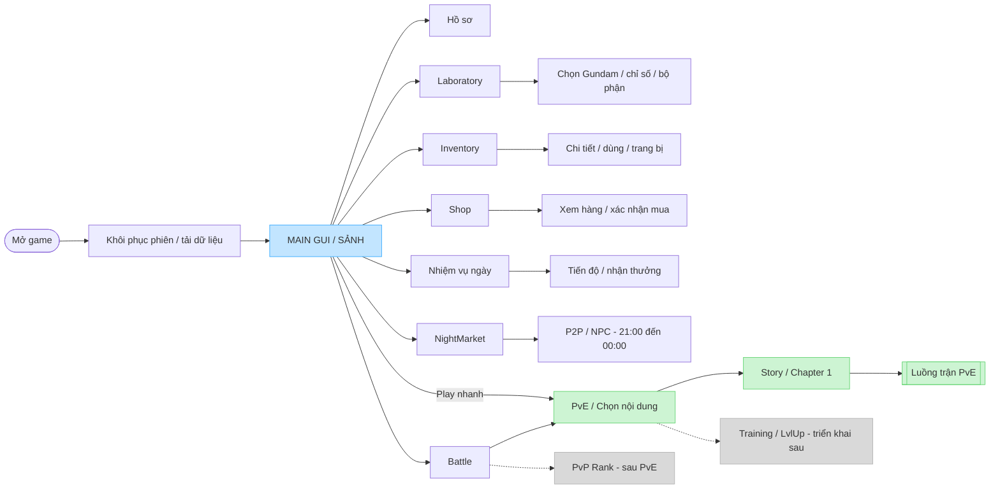
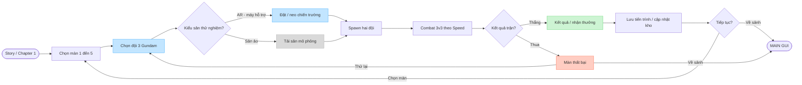

# AR Transformer Gundam — Main flow màn hình V0.1

Ngày lập: 04/11/2026.

Tài liệu mô tả luồng màn hình mục tiêu theo GDD V0.1, có đối chiếu UI và các scene thử trong project. Sơ đồ không có nghĩa là toàn bộ chức năng đã được nối và hoàn thiện trong Unity.

Bản chỉnh sửa trực quan: [Mở hai sơ đồ trong FigJam](https://www.figma.com/board/piJyytQsD8tqZBkfHa4Pmu).

## 1. Điều hướng tổng thể

Quy ước: Main GUI là điểm điều hướng trung tâm; nhánh xanh lá là PvE đang được ưu tiên. Đường nét đứt và nhãn “sau PvE/triển khai sau” biểu thị các chế độ dành cho giai đoạn sau. Màu không biểu thị mức hoàn thiện của code.

- Play là lối vào nhanh của Battle → PvE; cả hai dùng cùng màn chọn nội dung.
- Các panel Hồ sơ, Laboratory, Inventory, Shop, Nhiệm vụ ngày và NightMarket có Back/Close để quay lại Main GUI. Không vẽ lặp tất cả mũi tên quay lại để sơ đồ dễ đọc.
- Laboratory có chọn Gundam, xem chỉ số, biểu đồ mạng nhện, focus bộ phận, nâng cấp và trang bị. Focus dùng highlight, giữ Gundam nguyên hình thể.
- Inventory chứa EXP, đá nâng cấp, vũ khí, core và vật phẩm theo catalog. Dùng vật phẩm cần chọn đích và xác nhận; trang bị/nâng cấp dùng chung quy tắc với Laboratory.
- Shop dùng Coin cho danh mục thông thường; giá và loại tiền phải hiển thị trước khi xác nhận.
- NightMarket có giao dịch P2P và NPC, mở 21:00–00:00 hằng ngày. Ngoài giờ hiển thị trạng thái đóng/giờ mở; nhiệm vụ ngày và các màn khác không bị khóa theo lịch này.
- Khôi phục phiên/tải dữ liệu là bước khởi tạo theo GDD. Sơ đồ chưa thêm một màn đăng nhập riêng khi UX đăng nhập chưa được chốt.

## 2. Luồng vào trận và kết quả PvE

- Chapter 1 gồm 5 màn: màn 1–3 có quái thường; màn 4 có một tinh anh và hai quái thường; màn 5 có một boss và hai quái thường.
- Chỉ cho chọn màn đã mở. Thắng màn trước mở màn kế tiếp; thắng màn 5 kết thúc nội dung Chapter 1 đang có, không tự mở một Chapter 2 chưa được thiết kế.
- Mỗi đội người chơi gồm 3 Gundam; actor hành động theo Speed, chọn mục tiêu và một trong 3 skill hoặc ulti.
- Nhánh chọn kiểu sân phục vụ thiết kế/thử nghiệm: AR cần thiết bị hỗ trợ và tracking/anchor hợp lệ; sân ảo dùng cho phát triển và máy không hỗ trợ. Chính sách AR bắt buộc hay tùy chọn khi phát hành chưa chốt.
- Cách neo AR cụ thể — mặt phẳng hoặc hologram trong không gian — chưa chốt trong sơ đồ tổng quan này.
- Mất tracking phải tạm dừng input, timer và animation, rồi khôi phục đúng trạng thái; không khởi tạo trận hoặc cấp thưởng lại.
- Kết quả thắng xác nhận thưởng, cập nhật kho và lưu tiến trình trước khi cho chơi tiếp. Ghi nhận lỗi đồng bộ và cho thử lại đồng bộ, tránh cấp trùng.
- Khi thua, người chơi có thể thử lại từ bước chọn đội hoặc quay về Main GUI.
- Coin, EXP và vật phẩm là phần thưởng PvE theo cấu hình. Burst là tài nguyên trong trận, không phải tiền tệ.

## 3. Đối chiếu trạng thái project

| Phần | Trạng thái đã xác nhận khi rà soát |
| --- | --- |
| Main GUI | Có scene HomeLobby và UI trưng bày Gundam |
| Inventory | Có panel mở/đóng, chọn nhóm, chọn vật phẩm; thao tác Use hiện mới là phản hồi prototype |
| Chọn Gundam | Có danh sách chọn, preview model/animation và xác nhận lựa chọn |
| Combat và animation | Có các scene thử độc lập cho Rouge/Unicorn; không xem đó là toàn bộ chuỗi Story đã nối với Main GUI |
| Laboratory đầy đủ, nâng cấp, Shop, NightMarket, nhiệm vụ và đồng bộ | Là các nhánh mục tiêu theo GDD cần tiếp tục triển khai hoặc kết nối; nhiều nút Main GUI hiện chỉ báo đang phát triển |
| PvP Rank, Training, LvlUp | Giữ trong định hướng, triển khai sau khi nền PvE ổn định |
| Artifact | Ngoài phạm vi V0.1; không thêm vào main flow hiện tại |

## 4. Nguồn đối chiếu

- `Docs/Design/GDD_AR_Transformer_Gundam_v0.1_Revised.md`: phạm vi, mục 2 về UI, mục 4 về Story, mục 5 về kinh tế và mục 6 về AR.
- `Assets/GundamLobby/Runtime/HomeLobbyController.cs` và `LobbyButtonAction.cs`: nhiều nút hiện hiển thị thông báo đang phát triển.
- `Assets/GundamLobby/Inventory/Runtime/InventoryPanel.cs`: luồng panel và phản hồi Use prototype.
- `Assets/GundamLobby/Striker/Runtime/StrikerSelectionController.cs`: luồng chọn và preview Gundam.

Các đường dẫn trong mục nguồn tính từ thư mục gốc project.

