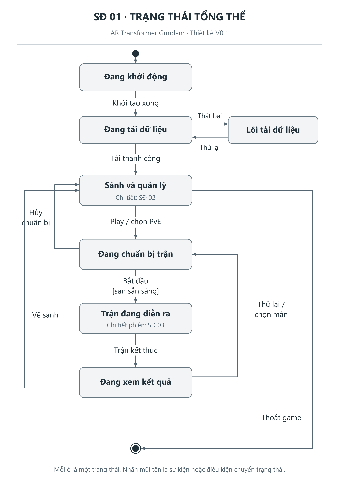
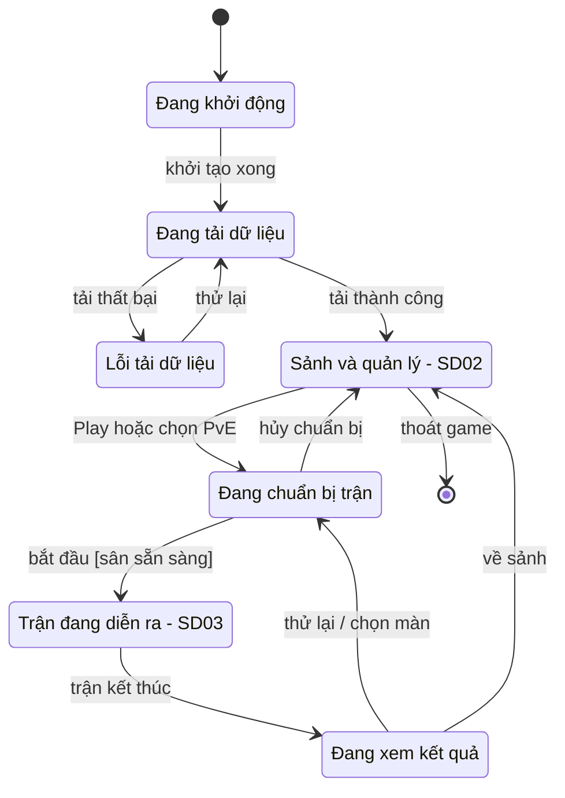
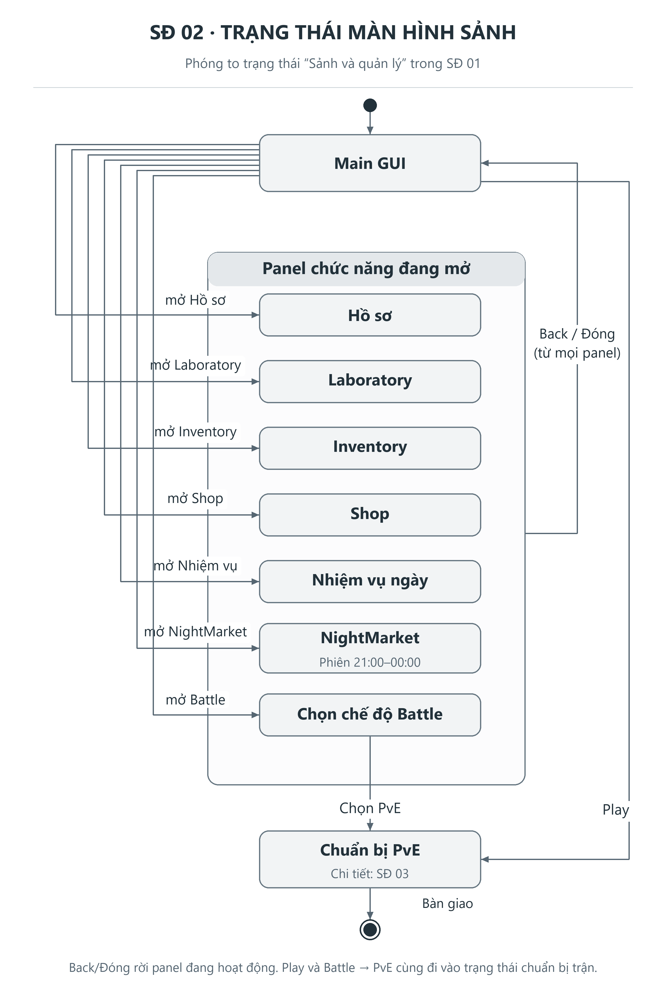
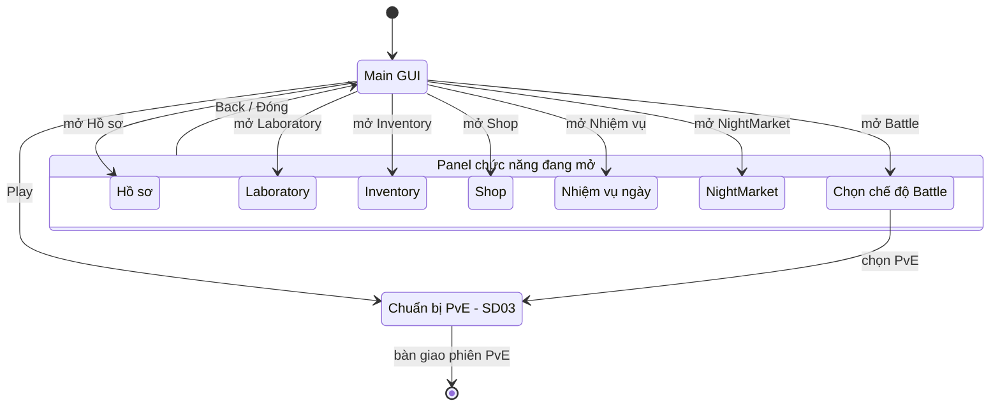
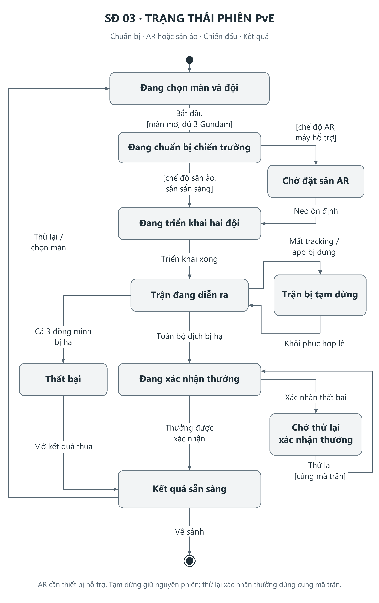
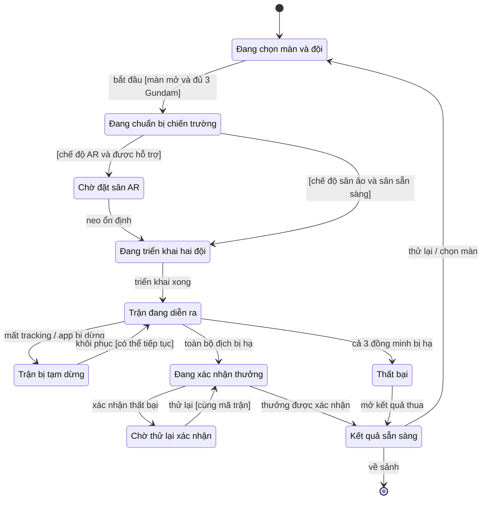

# Sơ đồ trạng thái AR Transformer Gundam V0.1

Ngày lập: 04/11/2026. Thiết kế đối chiếu GDD V0.1 và các màn hình đã thảo luận. Các hình mô tả trạng thái mục tiêu để nhóm triển khai; không xác nhận mọi trạng thái đã có trong code Unity.

## Cách đọc và đưa vào Word

- Ô bo góc là trạng thái; mũi tên là chuyển trạng thái; nhãn là sự kiện kích hoạt, kèm điều kiện trong dấu ngoặc vuông.
- Chấm đen là bắt đầu. Vòng tròn kép có chấm đen là kết thúc trong phạm vi sơ đồ.
- SĐ02 kết thúc khi bàn giao sang PvE; SĐ03 kết thúc khi về Sảnh. Chỉ kết thúc SĐ01 biểu diễn thoát game.
- Các hình đọc từ trên xuống. Đường vòng thể hiện hủy, Back, thử lại hoặc khôi phục trạng thái.
- Chèn mỗi PNG trên một trang A4 dọc, rộng khoảng 15–15,5 cm, giữ nguyên tỷ lệ và dùng In Line with Text. Đặt chú thích bên dưới.
- PNG rộng 2.700 px, thông tin 300 DPI, nền trắng. SVG là bản vector; MMD là nguồn Mermaid chỉnh sửa được. Không cần chụp màn hình để dán Word.

## SĐ 01 · TRẠNG THÁI TỔNG THỂ

## SĐ 02 · TRẠNG THÁI MÀN HÌNH SẢNH

## SĐ 03 · TRẠNG THÁI PHIÊN PvE

## Ghi chú ngữ nghĩa và phạm vi

1. SĐ01 mô tả vòng đời ứng dụng. SĐ02 mở rộng “Sảnh và quản lý”. SĐ03 mở rộng toàn bộ phiên PvE: chuẩn bị, chiến đấu và kết quả.
2. Trong SĐ02, khung “Panel chức năng đang mở” là trạng thái tổng hợp. Mỗi sự kiện mở đi thẳng vào một trạng thái con; Back/Đóng ở mức khung rời panel con đang hoạt động và về Main GUI.
3. Play và Battle → PvE dùng chung trạng thái chuẩn bị. Laboratory có chọn Gundam, chỉ số, focus bộ phận, nâng cấp và trang bị; chưa phân rã các thao tác trong panel thành sơ đồ riêng.
4. NightMarket vẫn có giao diện ngoài giờ. Lịch 21:00–00:00 chỉ mở giao dịch P2P/NPC, không khóa nhiệm vụ ngày và các màn khác.
5. PvP Rank, Training và LvlUp triển khai sau nền PvE. Khi chưa mở, UI giữ màn hiện tại và báo khóa. Artifact chưa thuộc V0.1.
6. Bắt đầu PvE yêu cầu màn đã mở và đủ 3 Gundam hợp lệ. Chapter 1 có 5 màn: ba màn thường; một tinh anh kèm hai quái; một boss kèm hai quái.
7. AR và sân ảo là hai chế độ thử nghiệm loại trừ nhau. AR cần thiết bị hỗ trợ và neo ổn định. Cách neo cụ thể và chính sách AR bắt buộc/tùy chọn khi phát hành chưa chốt.
8. Tạm dừng giữ lại phiên, actor, lượt, timer phản ứng và animation. Khôi phục tiếp tục đúng trạng thái; không tạo lại trận. Nếu dùng AR, tracking phải phù hợp khi tiếp tục.
9. Hạ hết địch chuyển sang xác nhận thưởng. Cả ba đồng minh bị hạ chuyển sang Thất bại. Kết quả thua không đi qua cấp thưởng thắng.
10. Thử lại xác nhận thưởng dùng cùng mã trận/giao dịch để tránh nhận trùng. Từ kết quả, thử lại trận/chọn màn là chuẩn bị một lần chơi mới và khởi tạo lại dữ liệu chiến đấu theo GDD.
11. “Trận đang diễn ra” bao trùm combat theo Speed; chưa phân rã đến từng actor, skill, Dodge hoặc Parry. Hủy chuẩn bị thể hiện ở SĐ01, không lặp lại trên mọi sơ đồ con.

## Trạng thái bàn giao

Các ảnh mô tả thiết kế V0.1. Main GUI, Inventory, chọn Gundam và các scene combat/animation hiện có vẫn là các phần prototype; nhiều nhánh quản lý, Story, giao dịch và đồng bộ cần triển khai hoặc kết nối tiếp.

Bộ này thay cho main flow trong mục đích mô tả trạng thái; main flow cũ vẫn là tài liệu điều hướng tham khảo. Figma MCP đang hết hạn mức Starter nên các sơ đồ trạng thái mới chưa được thêm vào board cũ. PNG, SVG và Mermaid tại đây là bản bàn giao đầy đủ.

Nguồn đối chiếu: `Docs/Design/GDD_AR_Transformer_Gundam_v0.1_Revised.md` và `Docs/Design/MainScreenFlow_v0.1.md`.

