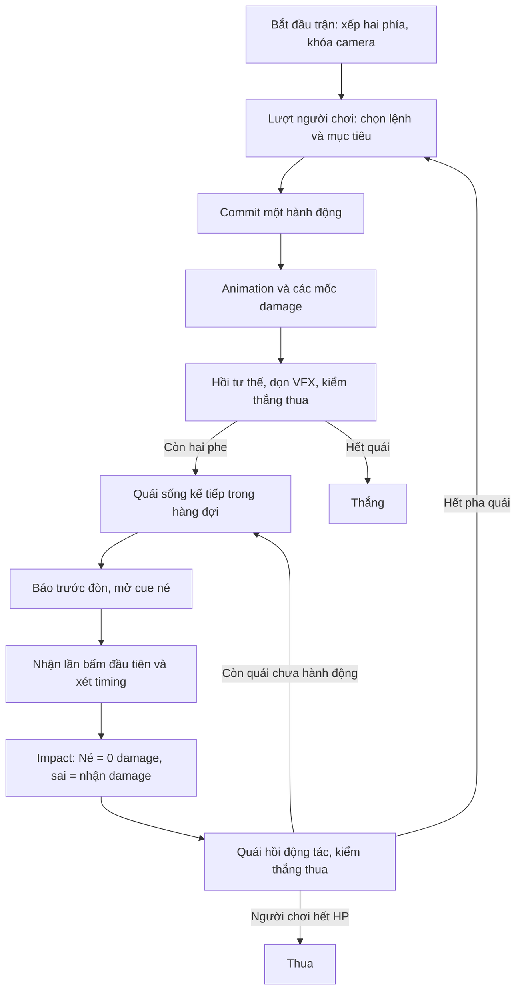

> ĐẶC TẢ MỚI NHẤT — 29/10/2026
> Đọc [master mới](2026-10-29-Camera-Flight-Weapons/00_MASTER_PROMPT_VI.md) và các prompt 01–05 cùng thư mục. Camera mặc định sau lưng nhưng xoay 360°; Attack, Skill và Ultimate đều bay tới phía địch rồi trở về; khớp chuyển động mượt và vũ khí chỉ rút khi dùng.
> Phần bên dưới là tài liệu ngày trước được giữ để tham chiếu. Các ràng buộc camera fixed, root tuyệt đối đứng yên khi đánh, skill/ultimate đứng tại chỗ hoặc súng cầm sẵn đã được thay thế.

---

# Phân tích thiết kế — đánh theo lượt, vị trí cố định, né đúng nhịp

Cập nhật 28/10/2026 theo yêu cầu mới của người dùng. Tài liệu này phân tích thiết kế và giải thích prompt đã sửa; chưa phải báo cáo triển khai gameplay trong Unity.

## 1. Hướng game đã xác định

Game dùng chiến đấu theo lượt với một yếu tố phản xạ khi phòng thủ. Người chơi ra quyết định trong lượt của mình; khi quái thực hiện đòn, người chơi bấm đúng thời điểm để né tại chỗ.

“Đứng cố định” áp dụng cho vị trí actor trên sân và khung camera. Nhân vật vẫn cần động tác tay, thân, chân, vũ khí để đánh, tụ lực, nhận đòn và né. Nếu khóa toàn bộ bone thì không thể có animation; phần cần cố định là BattleRoot/slot và camera.

| Nội dung | Trạng thái |
| --- | --- |
| Hai phe đứng ở hai phía, camera cố định | Người dùng đã yêu cầu |
| Người chơi đánh rồi quái đánh | Người dùng đã yêu cầu |
| Earth Prison là ultimate của nhân vật | Người dùng đã yêu cầu |
| Bấm đúng thời điểm để né tại chỗ | Người dùng đã chọn rõ |
| Người chơi trái, quái phải; 1v1 trước, mở rộng 1v3 | Phương án triển khai đề xuất |
| Phím Space né; UI/R Ultimate | Mapping đề xuất, chỉnh được |
| Thanh Ultimate 100, cách nạp, damage, cooldown skill | Thông số cân bằng đề xuất |
| Địch chưa có RNG né; lồng chưa gây stun/mất lượt | Phạm vi demo đề xuất để giữ luật lượt đơn giản |

## 2. Hai loại thời gian phải tách rõ

**Lượt/round** quyết định ai có quyền hành động và khi nào tài nguyên theo lượt được hồi. **Thời gian trong action** quyết định cue, animation, né, damage và VFX.

Ví dụ: người chơi có thể suy nghĩ 20 giây trong menu mà cooldown không tự giảm. Khi quái bắt đầu đòn dài 2 giây, cửa sổ né chạy theo action clock của 2 giây đó. Một ultimate dài 8 giây vẫn chỉ dùng một lượt.

Đây là lý do không nên giữ controller realtime rồi chỉ đặt tốc độ di chuyển về 0: code cũ vẫn có thể tự đánh, hồi tài nguyên theo giây, chạy camera hoặc dispatch damage ngoài lượt.

## 3. Vòng trận đề xuất

Ở 1v1, chuỗi đúng yêu cầu “tôi đánh rồi quái đánh”. Ở 1v3, đề xuất một lượt người chơi rồi mỗi quái sống lần lượt một hành động. Đây là lựa chọn mở rộng, không khẳng định người dùng đã chốt cơ chế đội hình nhiều quái.

## 4. Né tại chỗ nhưng vẫn đọc được va chạm

Né dựa trên timing; không cần nhân vật chạy ra khỏi hitbox. BattleRoot giữ nguyên; animation dùng nghiêng thân, hạ đầu/gối, xoay vai. Khi né thành công, hiệu ứng đòn đi sượt qua và HUD hiện “NÉ!”, HP giữ nguyên.

Đòn mẫu để tinh chỉnh:

| Mốc action của quái | Chức năng |
| --- | --- |
| 0,00 s | Bắt đầu chuẩn bị đòn |
| 0,30 s | Hiện cue; từ đây lần bấm đầu tiên được tính |
| 0,95–1,15 s | Cửa sổ né thành công |
| 1,20 s | Hit marker: resolve 0 hoặc damage đúng một lần |
| Khoảng 2,00 s | Hết hồi động tác, chuyển action/lượt |

Cửa sổ 0,20 s là đề xuất ban đầu, cần thử trên animation thật và có mức dễ rộng hơn. Không dùng số frame để định nghĩa vì FPS có thể thay đổi.

Một lần bấm quá sớm trong cue phải tiêu thụ cơ hội của hit đó; nếu cho bấm lại vô hạn, spam sẽ trở thành chiến thuật tối ưu. Giữ phím không tính là input mới; nhấn trước cue không được buffer tới thời điểm hợp lệ. Đa hit cần cue và lần nhấn riêng cho từng hit.

Không làm né thành công mà vẫn phát nổ ở ngực/giảm HP; không làm né xong thì người chơi giành lượt tấn công ngay. Action của quái phải resolve/recovery trước.

## 5. Earth Prison đổi vai trò ra sao

Giữ hình ảnh đã phân tích: tụ điện → tia sát đất → vòm xoáy vàng → sáu trụ đá → lồng sét → tan rã. Thay cách kích hoạt và điều phối:

| Yếu tố | Thiết kế hiện hành |
| --- | --- |
| Kích hoạt | Chọn Ultimate trong lượt người chơi, đủ gauge 100 |
| Mục tiêu | Tất cả quái sống phía đối diện tại commit |
| Vị trí | Người chơi tại slot; lồng quanh EnemyFormationAnchor |
| Camera | Giữ toàn cảnh hai phía suốt 8 s, không cắt/zoom/rung |
| Tài nguyên | Trừ100 khi xác nhận hợp lệ; tích lại bằng các action khác |
| Damage | 120 tại 3,35 s; bốn lần60 tại 5,10/5,50/5,90/6,30 s, mỗi target còn sống |
| Kết thúc | Dọn hiệu ứng, hồi pose, kiểm thắng/thua rồi mới mở EnemyPhase |

Vì actor đã đứng cố định, không cần “root để cấm di chuyển”. Gây stun mất lượt là một hiệu ứng gameplay khác, không tự thêm vì tên chiêu là Prison. Ở demo đầu, quái sống sẽ đánh bình thường sau khi ultimate kết thúc.

Các số damage/gauge là đề xuất cân bằng, không trích từ video. Việc các quái trong video biến mất không đủ chứng minh một cơ chế insta-kill.

## 6. Tạo cảm giác mạnh trong camera cố định

- Tư thế tụ lực rõ, vòng điện gom lại trước release.
- Đường tia nối nguồn và đích, giúp nhìn rõ ai đánh ai dù hai bên cách xa.
- Trụ mọc có nhịp, bụi/mảnh và sáu nút điện tăng sáng tuần tự ngắn.
- Glow, bụi và sét giữ khoảng trống để nhìn được quái và HP.
- Hit reaction và số damage khớp đúng marker, không dồn toàn bộ HP loss vào đầu cinematic.
- Tan rã xong mới cho cue né lượt quái xuất hiện, để người chơi không bị che tín hiệu.

Không cần camera shake/zoom để tạo lực. Camera fixed vẫn có thể đẹp nhờ animation, silhouette, tương phản sáng và thời điểm phát âm thanh.

## 7. Chuyển đổi từ project hiện có

Qua code đọc ngày 28/10, `MechaPlayer` là controller realtime, `MechaEnemy` có logic chase/attack theo khoảng cách, `MechaCamera` orbit/follow và cinematic R. Chúng không phù hợp làm controller trực tiếp cho battle cố định.

Tái sử dụng phần hình học, rig và clip phù hợp; tạo scene `TurnBattleDemo` với `BattleManager`, `ActionRunner`, `TimedDodgeController`, `DamageResolver` và `FixedBattleCamera`. Prefab battle không chạy controller realtime nền. Health và VFX cũ chỉ dùng lại sau khi kiểm phụ thuộc/callback.

Không yêu cầu dựng lại toàn model hoặc rig nếu tài nguyên hiện tại đã đạt. Công việc chính là đổi luật điều phối trận và dựng/tích hợp ultimate theo khung hình mới.

## 8. Thứ tự thực hiện hợp lý

1. Hai phía cố định + camera + một đòn player/enemy luân phiên.
2. Cue né, timing, một lần nhấn, đúng HP/hit/miss.
3. Command UI, Guard, ultimate gauge và cooldown theo lượt.
4. Earth Prison với timeline và năm marker trong một lượt.
5. Mở rộng hàng đợi 1v3, death/pause/restart, tinh chỉnh hình ảnh và đo hiệu năng.

Prompt chi tiết đã ghi các ca kiểm biên: spam, giữ phím, input khi pause, FPS thấp, chết giữa đa hit, callback lặp và lượt sau ultimate. Đây là các điểm quyết định game chơi đúng luật, ngoài việc hiệu ứng đẹp.

## 9. Tệp hiện hành

- `GUNDAM_TURN_BASED_MASTER_PROMPT_VI.md` / `.txt`: prompt tổng thể 20 mục.
- `GUNDAM_MASTER_PROMPT_VI.md` / `.txt`: bản cùng nội dung ở tên file cũ để tránh dùng nhầm hướng realtime.
- `EarthPrison/EARTH_PRISON_MASTER_PROMPT_VI.md` / `.txt`: prompt ultimate 22 mục, đã sửa luật lượt/camera/tài nguyên.
- `HUONG_DAN_SU_DUNG_PROMPT.md`: câu lệnh giao việc theo thiết kế mới.
- `Archive/2026-10-27-Realtime/`: bản trước khi sửa, chỉ giữ để tham khảo.

Lượt này chỉ cập nhật tài liệu và prompt. Chưa chuyển gameplay hoặc tạo scene theo lượt trong Unity.
